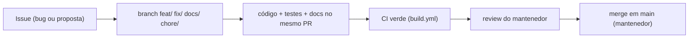

# Contribuindo com o SharpShot

> Como propor mudanças, abrir PRs e manter a documentação viva. Vale para pessoas e para assistentes de IA (que seguem também o [`CLAUDE.md`](CLAUDE.md)).
> Última atualização: 04/nov/2026 · Mantenedor: Victor Alves

## Antes de começar

1. Leia [`README.md`](README.md) → [`PROJECT_CONTEXT.md`](PROJECT_CONTEXT.md) → [`docs/ARCHITECTURE.md`](docs/ARCHITECTURE.md) → [`docs/DECISIONS.md`](docs/DECISIONS.md). Uma hora de leitura evita um PR que contradiz um ADR.
2. Confira o escopo: o que está em **fora de escopo** ([`docs/PRD.md`](docs/PRD.md#fora-de-escopo)) não entra sem ADR novo aprovado pelo mantenedor. O que está no **roadmap** pode entrar, mas abra uma issue antes para alinhar o desenho.
3. Monte o ambiente: [`docs/development/README.md`](docs/development/README.md). Build e testes em x64 precisam passar localmente antes do PR.

## Fluxo

- **Branch:** `feat/`, `fix/`, `docs/`, `chore/`, `refactor/` + slug kebab-case em pt-BR sem acento (`feat/captura-de-janela`, `fix/clamp-da-selecao`).
- **Commits:** Conventional Commits em pt-BR ([`docs/Code-Style.md`](docs/Code-Style.md#10-git)). Assistentes de IA **não** commitam, não criam branches nem tags — deixam a árvore de trabalho pronta para o mantenedor.
- **PR pequeno e coeso.** Um PR, uma mudança. Refatoração separada de feature.

## O que todo PR precisa

- [ ] `dotnet build SharpShot.slnx -c Debug -p:Platform=x64` sem erro e **sem warning novo** de analisador.
- [ ] `dotnet test` dos dois projetos de teste verde; teste novo para comportamento novo e para bug corrigido.
- [ ] Nenhuma dependência nova sem ADR (especialmente nativa, de UI ou de rede — ver [`CLAUDE.md`](CLAUDE.md)).
- [ ] `Core` e `Storage` continuam sem `using Windows.*`.
- [ ] Erro novo classificado em `CaptureErrorKind`/`SaveErrorKind` **e** com mensagem em [`docs/architecture/erros.md`](docs/architecture/erros.md).
- [ ] Interface nova ou alterada refletida em [`docs/API.md`](docs/API.md); campo novo em `settings.json` refletido em [`docs/DATABASE.md`](docs/DATABASE.md).
- [ ] `DllImport` novo na tabela de [`docs/capture-engine/interop.md`](docs/capture-engine/interop.md).
- [ ] Entrada em [`docs/CHANGELOG.md`](docs/CHANGELOG.md) (*Não publicado*) dizendo o quê **e o porquê**.
- [ ] Decisão técnica nova → ADR em [`docs/DECISIONS.md`](docs/DECISIONS.md) (próximo número; nunca renumerar).
- [ ] UI nova segue [`docs/DESIGN.md`](docs/DESIGN.md): sem hex no XAML, sem controle sem função, pt-BR.
- [ ] Assets só via `python tools/branding/generate_branding.py` — PNG/ICO/`LogoGeometry.cs` nunca editados à mão.
- [ ] Nada declarado "testado"/"validado" sem ter sido executado; o que falta está marcado "pendente de validação".

## Reportando bugs

Abra uma [issue](https://github.com/Victorkaue333/sharpshot/issues) com:

- Versão do Windows (`winver`) e arquitetura (x64/arm64).
- Número de monitores, resolução e escala (%) de cada um; HDR ligado?
- O que você fez (atalho, menu, card), o que esperava e o que aconteceu.
- A mensagem exata mostrada pelo app.
- O arquivo de log de `%LOCALAPPDATA%\SharpShot\logs` (não contém imagens).

Para captura "preta" ou parcial, diga qual aplicativo estava na tela — conteúdo protegido por DRM e janelas com `WDA_EXCLUDEFROMCAPTURE` saem pretas por design do Windows ([`docs/capture-engine/limitacoes.md`](docs/capture-engine/limitacoes.md)).

## Propondo features

Descreva o problema antes da solução. Diga se a proposta está no roadmap, se contradiz algum ADR e qual seria o impacto na promessa central (fidelidade, privacidade, simplicidade). Feature que adiciona rede, telemetria ou formato com perdas por padrão será recusada sem ADR do mantenedor.

## Documentação

- Docs em **pt-BR**; código, comentários e logs em **inglês**.
- Cada doc canônico tem cabeçalho com fontes e "Última atualização" — atualize a data quando mudar o conteúdo.
- Imagens: só mockups de `public/assets/` (rotulados como mockup) ou exports de `assets/branding/`. Nenhuma "captura do app rodando" até existir uma de verdade.
- Diagramas em Mermaid, dentro do `.md`.

## Código de conduta

Seja direto e respeitoso. Critique o código, não a pessoa. Discordâncias técnicas se resolvem com evidência (um teste, uma medição, uma referência de API) e, quando é decisão de desenho, com um ADR.

## Licença

Ao contribuir, você concorda que sua contribuição será distribuída sob a [licença MIT](LICENSE) do projeto.
