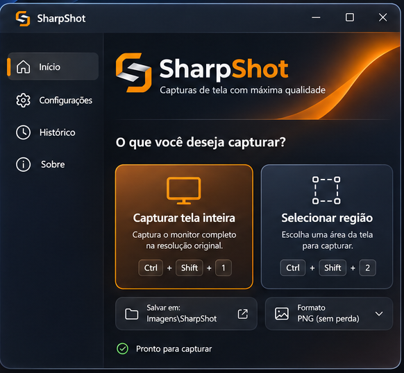
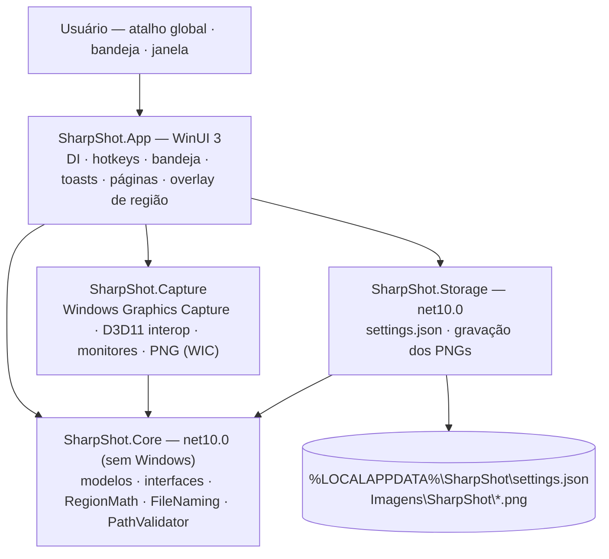
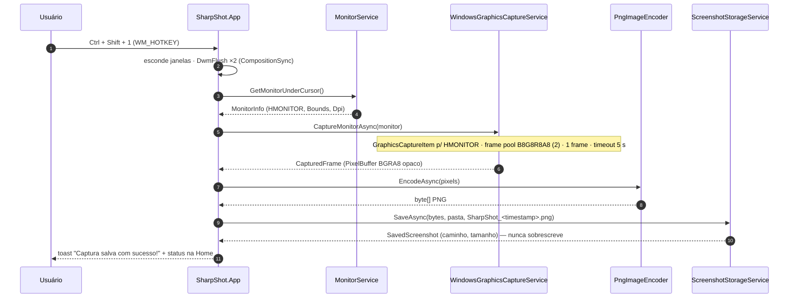
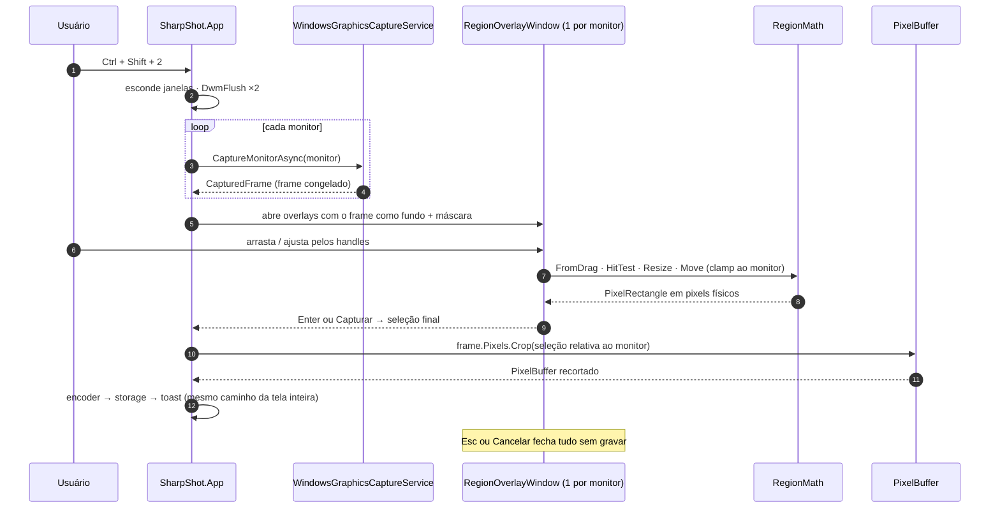

<p align="center">
  <picture>
    <source media="(prefers-color-scheme: dark)" srcset="assets/branding/sharpshot-horizontal-dark.png">
    
  </picture>
</p>

# SharpShot

[](https://dotnet.microsoft.com/)
[](https://learn.microsoft.com/windows/apps/winui/winui3/)
[](https://learn.microsoft.com/windows/apps/windows-app-sdk/)
[%20%7C%2011-0078D4?logo=windows&logoColor=white)](docs/distribution/compatibilidade.md)
[](docs/distribution/compatibilidade.md)
[](docs/CHANGELOG.md)
[-FF7A00)](docs/PRD.md)
[](LICENSE)
[](https://github.com/Victorkaue333/sharpshot/actions/workflows/build.yml)

> **Capture a tela exatamente como ela é.** Ferramenta nativa e leve de captura de tela para Windows 10/11 — tela inteira ou região, salva em **PNG sem perdas**, em pixels físicos, com um atalho de teclado. Sem conta, sem nuvem, sem telemetria.

**Repositório:** [github.com/Victorkaue333/sharpshot](https://github.com/Victorkaue333/sharpshot) · **Autor:** Victor Alves · **Licença:** MIT · **Status:** em desenvolvimento — MVP `0.1.0` (todos os projetos implementados; 320 testes automatizados verdes; captura, overlay, notificações e configurações validados na máquina do autor — ver [`docs/project-context/criterios-de-aceitacao.md`](docs/project-context/criterios-de-aceitacao.md)).

---

## Sumário

1. [Visão geral](#visão-geral)
2. [Pré-requisitos](#pré-requisitos)
3. [Arquitetura](#arquitetura)
4. [Stack](#stack)
5. [Estrutura de pastas](#estrutura-de-pastas)
6. [Setup local](#setup-local)
7. [Comandos úteis](#comandos-úteis)
8. [Documentação](#documentação)
9. [Convenções](#convenções)
10. [Roadmap](#roadmap)
11. [Créditos de terceiros](#créditos-de-terceiros)
12. [Ajuda](#ajuda)

## Visão geral

SharpShot faz uma coisa bem: tira a foto do que está na tela e salva como arquivo.

| Recurso | Como | Status |
|---------|------|--------|
| **Captura de tela inteira** — `Ctrl + Shift + 1` | Windows Graphics Capture do monitor sob o cursor, composto pelo DWM (funciona com DirectX e apps em tela cheia) | implementado e validado |
| **Seleção de região** — `Ctrl + Shift + 2` | Frame **congelado** como fundo de um overlay por monitor; borda laranja, 8 handles, badge "1280 × 720"; `Enter` captura, `Esc` cancela | implementado e validado |
| **PNG sem perdas** | WIC `BitmapEncoder`, BGRA8 → RGB 8-bit, sem reamostragem, sem filtro, sem conversão de cor | implementado |
| **DPI exato** | PerMonitorV2; monitores com 100 %/125 %/150 % lado a lado, coordenadas negativas | implementado (`Core` + `Capture`) |
| **Nunca sobrescreve** | `SharpShot_2026-11-04_14-32-07-583.png`, sufixo `_1`, `_2`… em colisão | implementado |
| **Bandeja e atalhos globais** | `Shell_NotifyIcon` + `RegisterHotKey` (conflito detectado e avisado na tela inicial) | implementado (atalhos e ícone validados; menu da bandeja pendente de validação) |
| **Notificação com ações** | Toast "Captura salva com sucesso!" com **Abrir pasta** / **Ver imagem** | implementado e validado |
| **Configurações** | Iniciar com o Windows · Minimizar para a bandeja · Notificação · Atalhos · Pasta · Tema (Sistema/Claro/Escuro) | implementado e validado |
| **Sem instalador** | Pasta self-contained: copie e execute `SharpShot.exe` | configurado no `.csproj` · primeiro publish pendente |
| **Zero rede** | Nenhuma conexão, nenhuma telemetria | por desenho (ADR-15) |

Limitações assumidas no MVP: HDR não é preservado (o PNG é sempre SDR 8-bit), captura de um monitor por vez, sem cursor, só PNG. Lista completa em [`docs/capture-engine/limitacoes.md`](docs/capture-engine/limitacoes.md).

<p align="center">
  <br>
  <sub><em>Mockup de referência da tela inicial (não é uma captura do aplicativo rodando).</em></sub>
</p>

## Pré-requisitos

Para **usar**: Windows 10 versão 2004 (build 19041) ou superior, ou Windows 11; x64 (arm64 fica para uma versão futura). Nada a instalar — o runtime do .NET e do Windows App SDK vão dentro da pasta.

Para **desenvolver**:

| Requisito | Versão | Instalação |
|-----------|--------|------------|
| Windows 10 2004+ / Windows 11 (sessão de desktop) | — | — |
| .NET SDK | 10.0.x (`global.json`: `10.0.100`, `rollForward: latestFeature`) | `winget install Microsoft.DotNet.SDK.10` |
| Windows SDK 10.0.26100 + BuildTools | vêm pelo NuGet no `dotnet restore` | automático |
| Visual Studio 2022 17.14+ *(opcional)* | workload **.NET Desktop Development** + componente **Windows App SDK C# Templates** | Visual Studio Installer |
| Python 3.10+ e Pillow *(só para regenerar o branding)* | — | `pip install pillow` |

Detalhes e alternativas: [`docs/development/README.md`](docs/development/README.md).

## Arquitetura

Quatro projetos .NET 10 com uma regra: **tudo aponta para `Core`, nada em `Core` aponta para o Windows** (ADR-12). O App compõe os serviços por injeção de dependência.

### Componentes



### Fluxo — captura de tela inteira



### Fluxo — seleção de região



Mais: [`docs/ARCHITECTURE.md`](docs/ARCHITECTURE.md) · [`docs/architecture/fluxos.md`](docs/architecture/fluxos.md) · [`docs/capture-engine/README.md`](docs/capture-engine/README.md).

## Stack

| Camada | Tecnologia | Versão | Por quê |
|--------|------------|--------|---------|
| Linguagem / runtime | C# (`LangVersion latest`) · .NET | 10.0 | Nullable, records, source generators, self-contained |
| UI | WinUI 3 (Windows App SDK) | 2.6.5 | Fluent nativo, `NavigationView`, barra de título custom; unpackaged ([ADR-01](docs/DECISIONS.md)) |
| Captura | `Windows.Graphics.Capture` + Direct3D 11 (`D3D11CreateDevice`, WARP fallback) | SO | DWM-composto, DPI-exato, DirectX/fullscreen ([ADR-02](docs/DECISIONS.md)) |
| Cópia GPU→CPU | `SoftwareBitmap.CreateCopyFromSurfaceAsync` | SO | Sem binding D3D (Vortice/Win2D) ([ADR-03](docs/DECISIONS.md)) |
| Codificação | WIC `Windows.Graphics.Imaging.BitmapEncoder` (PNG) | SO | Sem perdas, sem dependência ([ADR-04](docs/DECISIONS.md)) |
| Atalhos / bandeja | `RegisterHotKey` · `Shell_NotifyIcon` (Win32) | SO | [ADR-05](docs/DECISIONS.md), [ADR-06](docs/DECISIONS.md) |
| Notificações | `AppNotificationManager` (Windows App SDK) | 2.6.5 | Funciona unpackaged ([ADR-07](docs/DECISIONS.md)) |
| DI / logging | `Microsoft.Extensions.DependencyInjection` · `Logging` (+ `Debug`) | 10.0.14 | Padrão .NET, sem framework de app |
| Configurações | `System.Text.Json` source-generated → `settings.json` | SDK | [ADR-09](docs/DECISIONS.md) |
| Testes | xUnit · `Microsoft.NET.Test.Sdk` | 2.9.3 · 17.14.1 | `Core` testável sem Windows ([ADR-12](docs/DECISIONS.md)) |
| Branding | Python 3.10+ · Pillow | — | Fonte única do logo e ícones ([ADR-13](docs/DECISIONS.md)) |
| CI | GitHub Actions (`windows-latest`) | — | restore · build · test · publish artifact |

Sem MVVM framework, sem Vortice/Win2D, sem WebView, sem biblioteca de UI de terceiros, sem rede.

## Estrutura de pastas

```text
sharpshot/
├── SharpShot.slnx                 solução (x64)
├── Directory.Build.props          versão 0.1.0, nullable, analisadores, pt-BR
├── Directory.Packages.props       versões centrais (Windows App SDK 2.6.5, Extensions 10.0.14, xunit 2.9.3)
├── global.json                    SDK 10.0.100 (latestFeature)
├── .editorconfig · .gitignore
├── README.md · PROJECT_CONTEXT.md · CLAUDE.md · CONTRIBUTING.md · LICENSE
├── src/
│   ├── SharpShot.Core/            net10.0 — Models · Enums · Interfaces · Exceptions · Services (RegionMath, FileNaming, PathValidator)
│   ├── SharpShot.Capture/         net10.0-windows — Interop · Graphics · Services (WGC, monitores, DwmFlush) · Encoding (PNG)
│   ├── SharpShot.Storage/         net10.0 — Configuration (settings.json) · Services (gravação)
│   └── SharpShot.App/             WinUI 3 — Program.cs · App.xaml · MainWindow · app.manifest · Assets/ · Components/LogoGeometry.cs (gerado)
├── tests/
│   ├── SharpShot.Core.Tests/      xUnit (Core + Storage) — 285 testes
│   └── SharpShot.Capture.Tests/   xUnit (Capture) — 35 testes
├── tools/branding/generate_branding.py   fonte única do logo → assets/ e src/SharpShot.App/Assets
├── assets/branding/ · assets/icons/      SVG/PNG do logo · .ico (app, bandeja) e PNGs 16–256
├── public/assets/                 mockups de referência (branding e telas) · public/branding, public/icons (cópias para a web)
├── docs/                          documentação canônica (pt-BR) — ver "Documentação"
└── .github/workflows/build.yml    CI (restore · build · test · publish)
```

## Setup local

1. **Clone**

   ```bash
   git clone https://github.com/Victorkaue333/sharpshot.git
   cd sharpshot
   ```

2. **SDK** — instale o .NET SDK 10 e confira que o `global.json` é satisfeito:

   ```bash
   winget install Microsoft.DotNet.SDK.10
   dotnet --version        # 10.0.x
   ```

3. **Restore** — baixa o Windows App SDK, o targeting pack do Windows SDK 10.0.26100 e os BuildTools (transitivos). Não é preciso instalar o Windows SDK pelo Visual Studio Installer.

   ```bash
   dotnet restore SharpShot.slnx
   ```

4. **Build** — sempre com plataforma explícita (WinUI não compila AnyCPU):

   ```bash
   dotnet build SharpShot.slnx -c Debug -p:Platform=x64
   ```

5. **Testes** (os projetos existem; os testes estão sendo escritos):

   ```bash
   dotnet test tests/SharpShot.Core.Tests -c Debug -p:Platform=x64
   dotnet test tests/SharpShot.Capture.Tests -c Debug -p:Platform=x64
   ```

6. **Executar**

   ```text
   src\SharpShot.App\bin\x64\Debug\net10.0-windows10.0.26100.0\win-x64\SharpShot.exe
   ```

   Ou abra `SharpShot.slnx` no Visual Studio 2022 17.14+, defina `SharpShot.App` como projeto de inicialização, plataforma **x64**, e pressione F5. Configuração de debug, símbolos e logs: [`docs/development/debug.md`](docs/development/debug.md).

7. **(Opcional) Regenerar o branding** — só se mudar o logo:

   ```bash
   pip install pillow
   python tools/branding/generate_branding.py
   ```

> Não rode dois `dotnet build` ao mesmo tempo no mesmo checkout: `obj/` corrompe.

## Comandos úteis

| Comando | O que faz |
|---------|-----------|
| `dotnet restore SharpShot.slnx` | Restaura pacotes (Windows App SDK, Extensions, xunit, Windows SDK targeting pack) |
| `dotnet build SharpShot.slnx -c Debug -p:Platform=x64` | Compila tudo em Debug x64 |
| `dotnet test tests/SharpShot.Core.Tests -c Debug -p:Platform=x64` | Testes de `Core` + `Storage` (sem Windows) |
| `dotnet test tests/SharpShot.Capture.Tests -c Debug -p:Platform=x64` | Testes de `Capture` (integração pulada sem WGC) |
| `src\SharpShot.App\bin\x64\Debug\net10.0-windows10.0.26100.0\win-x64\SharpShot.exe` | Executa o build Debug |
| `dotnet publish src/SharpShot.App/SharpShot.App.csproj -c Release -p:Platform=x64 -r win-x64 --self-contained -o artifacts/publish/win-x64` | Pasta self-contained x64 |
| `python tools/branding/generate_branding.py` | Regenera logo, ícones, assets do App e `LogoGeometry.cs` |
| `dotnet format SharpShot.slnx` | Aplica o `.editorconfig` |

Lista completa, com flags e saídas esperadas: [`docs/development/comandos.md`](docs/development/comandos.md).

### Release (pacote distribuível)

| Comando | O que faz |
| ------- | ---------- |
| `pwsh tools/release/make-release.ps1` | `dotnet publish` (Release, win-x64, self-contained) → copia o runtime VC++ (`vcruntime140*.dll`, `msvcp140*.dll`, `concrt140.dll`) do Redist do Visual Studio → remove `.pdb` → gera `artifacts/release/SharpShot-<versão>-win-x64.zip` + `.sha256` |
| `git tag v0.1.0 && git push origin main --tags` | Dispara `.github/workflows/release.yml`: testes, pacote e **GitHub Release com o zip anexado** |
| `gh release create v0.1.0 artifacts/release/SharpShot-0.1.0-win-x64.zip` | Alternativa manual com o zip gerado localmente |

> Validado em 04/nov/2026: zip de 66,5 MB; o `SharpShot.exe` publicado abre, registra atalhos e captura. Sem instalador: descompacte e execute. Detalhes em [`docs/distribution/`](docs/distribution/README.md).

## Documentação

Camada canônica fina e autoritativa em [`docs/`](docs/INDEX.md): resume e linka o detalhamento em vez de duplicar. Tudo em pt-BR.

| Documento | O que responde |
|-----------|----------------|
| [`PROJECT_CONTEXT.md`](PROJECT_CONTEXT.md) | Por que o SharpShot existe, para quem, o que é sucesso |
| [`CLAUDE.md`](CLAUDE.md) | Regras para assistentes de IA atuarem neste repo (uso de modelos, sem commits, comandos, decisões fixas) |
| [`CONTRIBUTING.md`](CONTRIBUTING.md) | Como contribuir: fluxo, PR, checklist |
| [`docs/INDEX.md`](docs/INDEX.md) | Mapa de toda a documentação |
| [`docs/PRD.md`](docs/PRD.md) | Requisitos do produto (resumo), fluxos, critérios de aceite, roadmap |
| [`docs/ARCHITECTURE.md`](docs/ARCHITECTURE.md) | Arquitetura, projetos, integrações com o sistema, decisões-chave |
| [`docs/API.md`](docs/API.md) | **Contratos internos** (interfaces do `Core` e implementações) — não há HTTP |
| [`docs/DATABASE.md`](docs/DATABASE.md) | **Persistência local**: `settings.json` campo a campo, pasta de capturas, logs, registro — não há banco |
| [`docs/DEPLOY.md`](docs/DEPLOY.md) | Como uma versão é publicada (publish + release) |
| [`docs/ENVIRONMENT.md`](docs/ENVIRONMENT.md) | Ambiente de build e execução (SDKs, propriedades, pastas, CI) — não há `.env` |
| [`docs/DECISIONS.md`](docs/DECISIONS.md) | ADR-01..15 |
| [`docs/CHANGELOG.md`](docs/CHANGELOG.md) | Histórico por versão, com o porquê |
| [`docs/DESIGN.md`](docs/DESIGN.md) · [`docs/design-system/`](docs/design-system/README.md) | Guia de design e design system (cores, tipografia, componentes, estados, ícones, temas, branding, assets) |
| [`docs/Code-Style.md`](docs/Code-Style.md) | Estilo de código (espelha o `.editorconfig`) |
| [`docs/project-context/`](docs/project-context/README.md) | Visão, público, objetivos, RF-xx, RNF-xx, critérios de aceitação, fora de escopo |
| [`docs/architecture/`](docs/architecture/README.md) | Responsabilidades, NuGet, fluxos (sequência), recursos nativos, erros |
| [`docs/capture-engine/`](docs/capture-engine/README.md) | WGC, interop, região, DPI/monitores, SDR/HDR, PNG, limitações |
| [`docs/development/`](docs/development/README.md) | Setup, Visual Studio, comandos, debug |
| [`docs/distribution/`](docs/distribution/README.md) | Publicação, empacotamento, runtime, instalação/desinstalação, compatibilidade |

**Ordem de leitura sugerida:** `README.md` → `PROJECT_CONTEXT.md` → `docs/PRD.md` → `docs/ARCHITECTURE.md` → `docs/capture-engine/README.md` → `docs/DECISIONS.md` → `docs/development/README.md`. Para IA: `CLAUDE.md` primeiro.

## Convenções

- **Código, comentários e logs em inglês; UI e documentação em pt-BR** ([ADR-14](docs/DECISIONS.md)).
- **`.editorconfig` manda:** namespaces file-scoped, chaves sempre, `_camelCase` em campos privados, sem primary constructors, CRLF, 4 espaços. Detalhe em [`docs/Code-Style.md`](docs/Code-Style.md).
- **Core sem Windows.** Interface nova entra em `Core/Interfaces` e em [`docs/API.md`](docs/API.md) no mesmo PR.
- **Erros sempre classificados** (`CaptureErrorKind`, `SaveErrorKind`) e explicados em pt-BR ([`docs/architecture/erros.md`](docs/architecture/erros.md)).
- **Commits:** Conventional Commits em pt-BR, feitos pelo mantenedor (assistentes de IA não commitam). PR com CI verde, docs afetadas e `CHANGELOG.md` atualizado ([`CONTRIBUTING.md`](CONTRIBUTING.md)).
- **Assets só pelo script** (`tools/branding/generate_branding.py`); nunca editar PNG/ICO/`LogoGeometry.cs` à mão.
- **Honestidade:** nada é declarado validado sem execução; o que não foi executado está marcado "pendente de validação".

## Roadmap

Nada abaixo está implementado. Ordem indicativa, sem datas ([`docs/PRD.md`](docs/PRD.md#roadmap-não-implementado)).

- [ ] Histórico de capturas (página "Histórico")
- [ ] Captura de janela
- [ ] Captura com cursor (opção)
- [ ] Formatos JPEG / WebP (atrás de `IImageEncoder`)
- [ ] Copiar para a área de transferência
- [ ] Anotações (setas, retângulos, texto)
- [ ] Internacionalização (`.resw`, en-US)
- [ ] MSIX / Microsoft Store
- [ ] HDR 16-bit

Fora de escopo por desenho: backend, API REST, banco de dados, autenticação, telemetria, qualquer uso de internet.

## Créditos de terceiros

| Componente | Licença | Uso |
|------------|---------|-----|
| [.NET 10](https://github.com/dotnet/runtime) (Microsoft) | MIT | Runtime e BCL (embutidos no publish) |
| [Windows App SDK / WinUI 3](https://github.com/microsoft/WindowsAppSDK) 2.6.5 (Microsoft) | MIT | UI, `AppNotificationManager`, `AppInstance` (embutidos no publish) |
| [Microsoft.Extensions.DependencyInjection / Logging](https://github.com/dotnet/runtime) 10.0.14 | MIT | Composição e logs |
| [xUnit](https://github.com/xunit/xunit) 2.9.3 · `xunit.runner.visualstudio` 3.1.5 · `Microsoft.NET.Test.Sdk` 17.14.1 | Apache-2.0 · Apache-2.0 · MIT | Testes (não distribuídos) |
| `Microsoft.Windows.SDK.BuildTools` 10.0.26100.4654 · `Microsoft.Windows.SDK.NET.Ref` | Licença Microsoft (ferramenta de build) | Build (não distribuídos) |
| `Microsoft.Web.WebView2` 1.0.3719.77 | Licença Microsoft (BSD-style) | **Dependência transitiva do WinUI; o SharpShot não usa WebView** — conferir se é copiado no publish |
| [Pillow](https://python-pillow.org/) | HPND/MIT-CMU | Só para gerar o branding (não distribuído) |
| Segoe UI Variable · Segoe Fluent Icons (Microsoft) | Fontes do sistema | Usadas em runtime; **não** embutidas |
| [Shields.io](https://shields.io/) · [Mermaid](https://mermaid.js.org/) | CC0 · MIT | Badges e diagramas deste README |

APIs do Windows (Windows Graphics Capture, Direct3D 11, WIC, Win32) são parte do sistema operacional.

## Ajuda

- **Dúvida sobre uso ou comportamento** → [`docs/PRD.md`](docs/PRD.md) e [`docs/capture-engine/limitacoes.md`](docs/capture-engine/limitacoes.md).
- **Erro ao capturar ou salvar** → a mensagem na tela vem de [`docs/architecture/erros.md`](docs/architecture/erros.md), que diz o que fazer; os logs ficam em `%LOCALAPPDATA%\SharpShot\logs`.
- **Problema de build** → [`docs/development/README.md`](docs/development/README.md) (SDK, Visual Studio, plataforma x64) e [`docs/ENVIRONMENT.md`](docs/ENVIRONMENT.md).
- **Bug ou sugestão** → [abra uma issue](https://github.com/Victorkaue333/sharpshot/issues) com versão do Windows, escala de DPI, número de monitores e o log.
- **Contribuir** → [`CONTRIBUTING.md`](CONTRIBUTING.md).

---

Distribuído sob a [licença MIT](LICENSE) · Copyright (c) 2026 Victor Alves · **Última atualização:** 04/nov/2026
