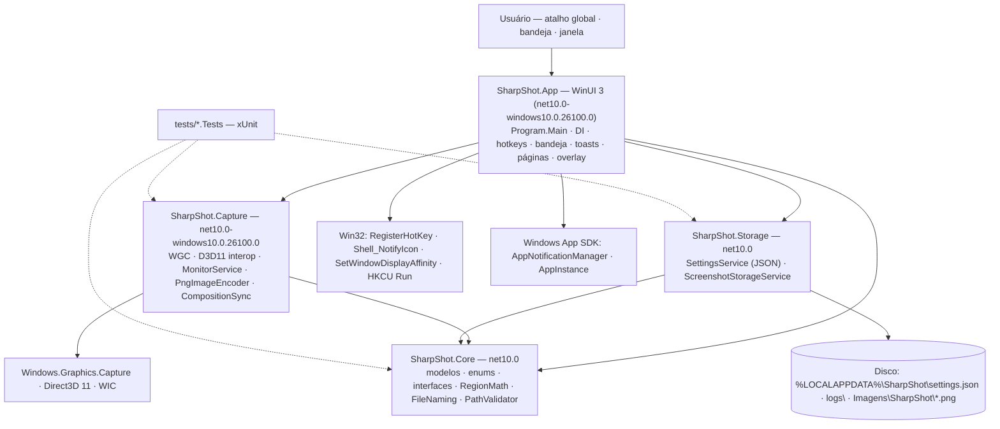
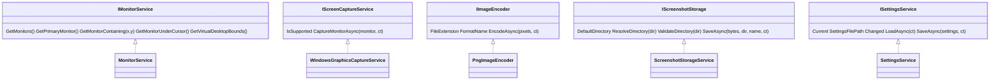

# ARCHITECTURE — SharpShot

> Camada **autoritativa e concisa** da arquitetura. O detalhamento e o "porquê" ficam nos docs-fonte: [`../CLAUDE.md`](../CLAUDE.md) (decisões fixas) · [`DECISIONS.md`](DECISIONS.md) (ADRs) · [`architecture/`](architecture/README.md) (responsabilidades, fluxos, recursos, erros) · [`capture-engine/`](capture-engine/README.md) (motor de captura).
> Última atualização: 04/nov/2026 · Mantenedor: Victor Alves · Status do código: `Core`, `Capture`, `Storage` e `App` **implementados**; 320 testes automatizados **verdes**; captura validada na máquina do autor (ver [`project-context/criterios-de-aceitacao.md`](project-context/criterios-de-aceitacao.md)).

## Visão geral

SharpShot é um **aplicativo desktop único**, sem servidor, dividido em quatro projetos .NET 10 com uma regra de dependência estrita: **tudo aponta para `Core`, nada em `Core` aponta para o Windows**. O App compõe os serviços por injeção de dependência e é o único lugar onde WinUI 3, Win32 de janela (hotkeys, bandeja) e notificações aparecem.

Princípio norteador (ADR-12): *a lógica que pode ser testada sem uma sessão de desktop vive em `Core`*. Geometria de seleção, nomes de arquivo, validação de caminho, parse de atalhos e o modelo de configurações não tocam WinRT. O motor de captura (`Capture`) e a persistência (`Storage`) implementam as interfaces do `Core`; o `App` só orquestra.

## Diagrama de componentes

Não existe: rede, backend, banco de dados, autenticação, telemetria (ADR-15).

## Camadas e responsabilidades

| Projeto | TFM | Responsabilidade | Depende de |
|---------|-----|------------------|------------|
| **`SharpShot.Core`** | `net10.0` | Contratos e lógica pura: `PixelRectangle`, `PixelBuffer` (BGRA8, `Crop`, `ForceOpaque`), `MonitorInfo`, `HotkeyBinding` + `VirtualKeyNames`, `AppSettings`, records de resultado; enums (`CaptureMode`, `ThemeMode`, `HotkeyModifiers`, `ResizeHandle`, `CaptureErrorKind`, `SaveErrorKind`); exceções (`CaptureException`, `ScreenshotSaveException`); interfaces (`IMonitorService`, `IScreenCaptureService`, `IImageEncoder`, `IScreenshotStorage`, `ISettingsService`); serviços estáticos (`RegionMath`, `FileNaming`, `PathValidator`) | `Microsoft.Extensions.Logging.Abstractions` |
| **`SharpShot.Capture`** | `net10.0-windows10.0.26100.0` (min 19041) | Motor de captura: `NativeMethods`, `GraphicsCaptureInterop`, `Direct3DDeviceFactory`, `MonitorService`, `WindowsGraphicsCaptureService`, `CompositionSync`, `PngImageEncoder` | `Core` · WinRT (projeções do TFM) |
| **`SharpShot.Storage`** | `net10.0` | Persistência local: `SettingsService` (JSON atômico, source-gen), `ScreenshotStorageService` (pasta padrão, nome único, classificação de erro de E/S) | `Core` |
| **`SharpShot.App`** | `net10.0-windows10.0.26100.0` (min 19041) | Composição e UI: `Program.Main` custom, `App` (DI, logging), janela principal (`NavigationView`: Início · Configurações · Sobre), `RegionOverlayWindow`, janela message-only (hotkeys + bandeja), notificações, instância única, inicialização com o Windows | `Core` · `Capture` · `Storage` · Windows App SDK 2.6.5 · `Microsoft.Extensions.DependencyInjection` · `Logging` + `Logging.Debug` |
| **`tests/SharpShot.Core.Tests`** | `net10.0` | xUnit sobre `Core` **e** `Storage` (referencia os dois) — round-trip de settings, nomes, caminhos, `RegionMath`, `PixelBuffer.Crop`, parse/format de hotkey | **planejado** (só `.csproj`) |
| **`tests/SharpShot.Capture.Tests`** | `net10.0-windows10.0.26100.0` | xUnit sobre `Capture` — round-trip PNG via `BitmapDecoder`, enumeração de monitores, captura de integração (pulada sem WGC/sessão) | **planejado** (só `.csproj`) |

Solução: `SharpShot.slnx` (formato XML), plataforma **x64** (arm64 fica para uma versão futura) (WinUI não compila AnyCPU; `Directory.Build.props` força x64 quando vazio). Versão central de pacotes em `Directory.Packages.props`.

## Contratos internos

As cinco interfaces do `Core` são a "API" do sistema — assinaturas, implementações e lifetimes em [`API.md`](API.md). Resumo:

## Integrações com o sistema

Toda dependência de plataforma fica atrás de uma interface do `Core` ou isolada no `App`; nenhuma chega à lógica pura.

| Integração | Uso | Onde | Status |
|------------|-----|------|--------|
| **Windows Graphics Capture** | Frame do monitor em superfície D3D11 | `Capture` | implementado |
| **Direct3D 11 / DXGI** | Device para o frame pool (hardware → WARP) | `Capture` | implementado |
| **WIC (`BitmapEncoder`/`SoftwareBitmap`)** | Cópia GPU→CPU e PNG | `Capture` | implementado |
| **`user32`/`shcore`/`dwmapi`** | Monitores, DPI, cursor, `DwmFlush` | `Capture` | implementado |
| **`RegisterHotKey`** (`user32`) | Atalhos globais | `App` | implementado |
| **`Shell_NotifyIcon`** (`shell32`) | Bandeja + menu | `App` | implementado |
| **`SetWindowDisplayAffinity`** | Excluir janelas da captura | `App` | implementado |
| **`AppNotificationManager`** | Toasts com ações | `App` | implementado |
| **`AppInstance.FindOrRegisterForKey`** | Instância única | `App` | implementado |
| **Registro `HKCU\…\Run`** | Iniciar com o Windows | `App` | implementado |
| **`Microsoft.Extensions.Logging`** | `Debug` + logger de arquivo em `%LOCALAPPDATA%\SharpShot\logs` | `App` | implementado |

## Decisões-chave

Resumo; contexto e consequências em [`DECISIONS.md`](DECISIONS.md).

- **ADR-01** — WinUI 3 unpackaged self-contained como distribuição primária; MSIX secundário
- **ADR-02** — Windows Graphics Capture (DWM-composto, DPI-exato, DirectX/fullscreen) — HDR não preservado
- **ADR-03** — `SoftwareBitmap.CreateCopyFromSurfaceAsync` em vez de binding D3D11 (zero Vortice/Win2D)
- **ADR-04** — Só PNG no MVP, atrás de `IImageEncoder`
- **ADR-05** — `RegisterHotKey` + `MOD_NOREPEAT`; conflito detectado por `ERROR_HOTKEY_ALREADY_REGISTERED`
- **ADR-06** — `Shell_NotifyIcon` + menu popup Win32; readiciona em `TaskbarCreated`
- **ADR-07** — `AppNotificationManager` (funciona unpackaged; degrada sem toast)
- **ADR-08** — `HKCU\…\Run` com `--minimized`; `StartupTask` só se empacotar
- **ADR-09** — `settings.json` com STJ source generation, escrita atômica, backup de corrompido
- **ADR-10** — Região sobre frame congelado, um monitor por seleção; geometria no `Core`
- **ADR-11** — Sem framework MVVM (`ObservableObject`/`RelayCommand` próprios)
- **ADR-12** — `Core` (e `Storage`) sem Windows → testável em qualquer runner
- **ADR-13** — Branding de uma fonte vetorial Python; artefatos versionados
- **ADR-14** — UI pt-BR literal no MVP
- **ADR-15** — Sem rede, sem telemetria

## Gerenciamento de recursos e erros

- Cada captura cria e descarta: `GraphicsCaptureItem`, frame pool (2 buffers), sessão, `Direct3D11CaptureFrame`, `SoftwareBitmap`. Só o `IDirect3DDevice` é cacheado (e recriado após device-lost). Detalhe: [`architecture/recursos.md`](architecture/recursos.md).
- Erros chegam à UI **sempre classificados**: `CaptureException.Kind` (7 valores) e `ScreenshotSaveException.Kind` (7 valores) → tabela única de mensagens em pt-BR + ação sugerida. Detalhe: [`architecture/erros.md`](architecture/erros.md).

## Estratégia de evolução

O MVP é deliberadamente pequeno. O que já está preparado para crescer sem reescrita:

1. **Formatos** — novo `IImageEncoder` (JPEG/WebP via WIC); o App escolhe, o Storage grava bytes.
2. **Captura de janela** — `IGraphicsCaptureItemInterop.CreateForWindow` já está na vtable; falta UI de escolha.
3. **Histórico** — `CaptureResult` já carrega caminho, dimensões, modo, timestamp e tamanho; um repositório SQLite em `Storage` atrás de uma nova interface do `Core`.
4. **i18n** — strings literais hoje (ADR-14); extração para `.resw` é mecânica.
5. **MSIX** — `EnableMsixTooling=true` e os tiles já existem em `Assets/`; trocar `WindowsPackageType` e assinar.

**O que não entra sem ADR novo:** qualquer conexão de rede, qualquer dependência nativa além do Windows App SDK, hook de teclado global, formato com perdas como padrão.

---

Contratos: [`API.md`](API.md) · Persistência: [`DATABASE.md`](DATABASE.md) · Decisões: [`DECISIONS.md`](DECISIONS.md) · Motor de captura: [`capture-engine/README.md`](capture-engine/README.md)
