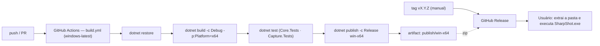

# DEPLOY — SharpShot (publicação)

> Camada autoritativa e concisa do processo de **publicação**: como o código vira uma pasta executável, como ela é validada e como chega ao usuário. Não há servidor nem ambiente remoto — "deploy" aqui é `dotnet publish` + GitHub Release. Detalhes de empacotamento, instalação e compatibilidade em [`distribution/`](distribution/README.md).
> Fonte das decisões fixas: [`../CLAUDE.md`](../CLAUDE.md) · [ADR-01](DECISIONS.md#adr-01--winui-3-unpackaged-e-self-contained-como-distribuição-primária) · Ambiente: [`ENVIRONMENT.md`](ENVIRONMENT.md).
> Última atualização: 04/nov/2026 · Mantenedor: Victor Alves

## Visão geral

Publicação **manual e versionada**: a cada versão (`<Version>` em `Directory.Build.props`, hoje `0.1.0`), o `dotnet publish` gera uma pasta self-contained por arquitetura, que é compactada e anexada a uma Release no GitHub. O CI (`.github/workflows/build.yml`, escrito pelo lead) garante que restore, build, testes e publish passam em `windows-latest` a cada push/PR e guarda a pasta publicada como artifact.



> **Nenhuma etapa automática cria tag, release ou commit.** Isso é sempre ação manual do mantenedor (regra fixa em [`../CLAUDE.md`](../CLAUDE.md)).

## Ambientes

| Ambiente | O que é | Como obter |
|----------|---------|------------|
| **dev / local** | Build Debug x64 na máquina do desenvolvedor | `dotnet build SharpShot.slnx -c Debug -p:Platform=x64` → `src\SharpShot.App\bin\x64\Debug\net10.0-windows10.0.26100.0\win-x64\SharpShot.exe` |
| **CI** | `windows-latest` do GitHub Actions; valida build, testes e publish | `.github/workflows/build.yml` |
| **release** | Pasta self-contained Release por arquitetura, zipada | `dotnet publish …` (abaixo) + GitHub Release |

Não existe staging nem produção no sentido de servidor. O "ambiente de produção" é a máquina do usuário: Windows 10 2004+ ou 11, x64 ([`distribution/compatibilidade.md`](distribution/compatibilidade.md)).

## Pipeline (`.github/workflows/build.yml`)

Arquivo de responsabilidade do lead; o que este doc espera dele:

| Etapa | Comando | Falha bloqueia? |
|-------|---------|-----------------|
| Restore | `dotnet restore SharpShot.slnx` | sim |
| Build | `dotnet build SharpShot.slnx -c Debug -p:Platform=x64 --no-restore` | sim |
| Testes Core | `dotnet test tests/SharpShot.Core.Tests -c Debug -p:Platform=x64 --no-build` | sim |
| Testes Capture | `dotnet test tests/SharpShot.Capture.Tests -c Debug -p:Platform=x64 --no-build` | sim — o teste de captura de integração **se pula** quando `IsSupported` é falso (runner sem sessão de desktop composta) |
| Publish | `dotnet publish src/SharpShot.App/SharpShot.App.csproj -c Release -p:Platform=x64 -r win-x64 --self-contained -o artifacts/publish/win-x64` | sim |
| Artifact | upload de `artifacts/publish/win-x64` | — |

Observações:

- O SDK vem de `global.json` (`10.0.100`, `rollForward: latestFeature`) via `actions/setup-dotnet`.
- Não há segredos: o workflow não assina nada e não publica release ([`ENVIRONMENT.md`](ENVIRONMENT.md#ci)).
- arm64: **fora do 0.1.0** (nunca compilado; removido de `Platforms`/`RuntimeIdentifiers`). Entra em versão futura com cross-build e validação em máquina ARM.

## Pacote de release (`tools/release/make-release.ps1` + `release.yml`)

1. `pwsh tools/release/make-release.ps1` — faz o `dotnet publish` (Release, `win-x64`, self-contained), copia o runtime VC++ (`vcruntime140.dll`, `vcruntime140_1.dll`, `msvcp140*.dll`, `concrt140.dll`) da pasta `VC\Redist\MSVC\<ver>\x64\Microsoft.VC143.CRT` do Visual Studio (se não encontrar, avisa; o pacote então depende do *Microsoft Visual C++ Redistributable 2015-2022 x64* instalado), remove `.pdb`, gera `artifacts/release/SharpShot-<versão>-win-x64.zip` (portátil) e compila o instalador `SharpShot-Setup-<versão>.exe` (Inno Setup, `installer/SharpShot.iss`), cada um com `.sha256` ao lado. O instalador é o download principal. Validado em 04/nov/2026 (66,5 MB; exe publicado abre e captura).
2. `git tag v0.1.0 && git push origin main --tags` — o workflow `release.yml` roda os testes unitários, executa o script e cria a **GitHub Release** com o zip e o hash anexados (`softprops/action-gh-release`). Alternativa manual: `gh release create v0.1.0 artifacts/release/SharpShot-0.1.0-win-x64.zip`.
3. Estado em 04/nov/2026: pacote gerado localmente; tag e push **ainda não feitos** (decisão do dono do repositório).

## Publicar uma versão (passo a passo manual)

1. **Versão:** atualizar `<Version>` em [`../Directory.Build.props`](../Directory.Build.props) e a `assemblyIdentity version` em [`../src/SharpShot.App/app.manifest`](../src/SharpShot.App/app.manifest); registrar em [`CHANGELOG.md`](CHANGELOG.md) (mover `[Não publicado]` para `[X.Y.Z] - data`).
2. **CI verde** no commit candidato.
3. **Publish local** (uma pasta por arquitetura):

   ```bash
   dotnet publish src/SharpShot.App/SharpShot.App.csproj -c Release -p:Platform=x64   -r win-x64   --self-contained -o artifacts/publish/win-x64
   ```

   `artifacts/` está no `.gitignore`.
4. **Smoke test** na pasta publicada ([`distribution/README.md`](distribution/README.md#checklist-de-validação-da-pasta-publicada)): abrir, capturar tela inteira e região, conferir PNG, toast, bandeja, Sair. Em VM limpa (sem .NET, sem Windows App SDK) pelo menos uma vez por versão.
5. **Zipar** a pasta como `SharpShot-<versão>-win-x64.zip` (o `make-release.ps1` faz isso e gera o `.sha256`).
6. **Tag e Release** no GitHub (manual): `v<versão>`, notas = seção do `CHANGELOG.md`, anexar os zips e o SHA-256 de cada um.

Checklist detalhado: [`distribution/README.md`](distribution/README.md).

## O que a pasta publicada contém

Self-contained: `SharpShot.exe`, `SharpShot.dll` e as três DLLs do projeto, o runtime do .NET 10 (`coreclr.dll`, `System.*.dll`…), o runtime do Windows App SDK (`Microsoft.WindowsAppRuntime.*.dll`, `Microsoft.ui.xaml.dll`, `Microsoft.UI.Xaml.Controls.dll`…), `WinRT.Runtime.dll`/`Microsoft.Windows.SDK.NET.dll`, `Assets\` (ícones, logo de notificação) e `resources.pri`. Lista exata, tamanho e presença das DLLs do VC++ runtime: **verificar na primeira pasta publicada** — [`distribution/README.md`](distribution/README.md#dependências-de-runtime).

## Rollback

| Camada | Como reverter |
|--------|---------------|
| **Release** | Marcar a release como *pre-release* ou removê-la; a anterior continua disponível. Usuário reverte copiando a pasta antiga — `settings.json` é compatível entre versões 0.x enquanto `schemaVersion` não mudar |
| **Código** | `git revert` + nova versão. Nunca reescrever tag publicada |
| **Configurações do usuário** | Não há migração destrutiva; arquivo corrompido vira backup automaticamente ([`DATABASE.md`](DATABASE.md)) |

## Checklist antes de publicar

Mínimos deste projeto: CI verde (restore + build + testes + publish) · `CHANGELOG.md` atualizado com o porquê · versão alinhada em `Directory.Build.props` e `app.manifest` · smoke test da pasta publicada em VM limpa · zips com SHA-256 · nenhuma dependência de rede introduzida (ADR-15) · docs afetadas atualizadas no mesmo PR.

**Status em 04/nov/2026:** nenhuma versão publicada; `0.1.0` é a versão alvo do MVP. O primeiro `dotnet publish` completo e o teste em VM limpa estão **pendentes de validação**.

---

Distribuição detalhada: [`distribution/README.md`](distribution/README.md) · Instalação: [`distribution/instalacao.md`](distribution/instalacao.md) · Compatibilidade: [`distribution/compatibilidade.md`](distribution/compatibilidade.md) · Decisões: [`DECISIONS.md`](DECISIONS.md) (ADR-01)
