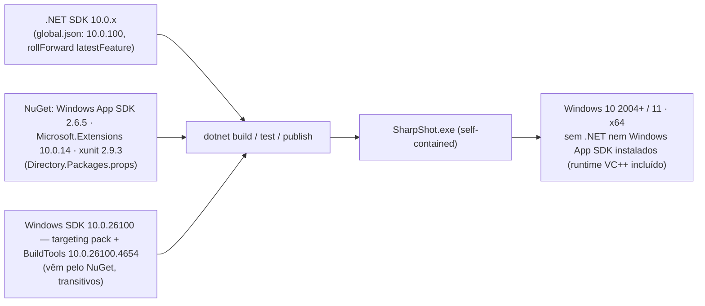

# ENVIRONMENT — SharpShot (ambiente)

> Catálogo autoritativo e conciso do **ambiente** de build e de execução. O SharpShot **não lê variáveis de ambiente de configuração** e não tem `.env` — não há segredos, chaves nem endpoints (ADR-15). Este arquivo documenta o que o build exige (SDKs, TFMs, `global.json`), o que o app lê do sistema em tempo de execução (pastas conhecidas, `%VAR%` na pasta de capturas) e o que o CI precisa.
> Relacionados: [`../CLAUDE.md`](../CLAUDE.md) · [`DEPLOY.md`](DEPLOY.md) · [`DATABASE.md`](DATABASE.md) · [`development/README.md`](development/README.md).
> Última atualização: 04/nov/2026 · Mantenedor: Victor Alves

## Visão geral

> Regra de ouro: **nada de configuração por variável de ambiente no app.** Toda preferência vive em `settings.json` ([`DATABASE.md`](DATABASE.md)). Se um dia for preciso um "modo de diagnóstico", ele entra como argumento de linha de comando documentado aqui, não como `SHARPSHOT_*` escondido.

## Ambiente de build

### Ferramentas

| Ferramenta | Versão | Fonte da verdade | Como instalar |
|------------|--------|------------------|---------------|
| .NET SDK | `10.0.100` ou superior na mesma major (`rollForward: latestFeature` aceita qualquer banda 10.0.x mais nova instalada) | [`../global.json`](../global.json) | `winget install Microsoft.DotNet.SDK.10` |
| Windows SDK (targeting pack `10.0.26100`) | `10.0.26100.0` | TFM `net10.0-windows10.0.26100.0` nos `.csproj` | Baixado pelo `dotnet restore` (`Microsoft.Windows.SDK.NET.Ref`); **não** precisa instalar o Windows SDK via Visual Studio Installer |
| Windows SDK BuildTools | `10.0.26100.4654` (+ `.MSIX 1.7.251221100`) | dependência transitiva do Windows App SDK (verificado em `obj/project.assets.json` do App) | automático no restore |
| Windows App SDK | `2.6.5` (`WinUI`, `Foundation`, `Runtime`) | [`../Directory.Packages.props`](../Directory.Packages.props) | automático no restore |
| Microsoft.Extensions.* | `10.0.14` | idem | automático |
| xunit / runner / Test.Sdk | `2.9.3` / `3.1.5` / `17.14.1` | idem | automático |
| Visual Studio 2022 17.14+ | opcional | — | workloads **.NET Desktop Development** + componente **Windows App SDK C# Templates**; ver [`development/README.md`](development/README.md) |
| Python 3.10+ e Pillow | só para regenerar branding | [`../tools/branding/generate_branding.py`](../tools/branding/generate_branding.py) | `pip install pillow` |
| Git | qualquer | — | — |

### Propriedades que definem o build

| Onde | Propriedade | Valor | Efeito |
|------|-------------|-------|--------|
| `Directory.Build.props` | `Version` | `0.1.0` | Versão de assembly/arquivo/informational |
| | `LangVersion` / `Nullable` / `ImplicitUsings` | `latest` / `enable` / `enable` | C# mais recente do SDK; nullable obrigatório |
| | `AnalysisLevel` | `latest-recommended` | Analisadores CA ligados (exceções no `.editorconfig`) |
| | `Platform` (fallback) | `x64` | WinUI não compila AnyCPU; build direto de um projeto assume x64 |
| | `NeutralLanguage` | `pt-BR` | Recursos neutros em pt-BR (ADR-14) |
| | `Deterministic` | `true` | Builds reproduzíveis |
| `Directory.Packages.props` | `ManagePackageVersionsCentrally` | `true` | Versão de pacote só aqui; `.csproj` não tem `Version=` |
| `SharpShot.App.csproj` | `WindowsPackageType` | `None` | Unpackaged (ADR-01) |
| | `SelfContained` / `WindowsAppSDKSelfContained` | `true` / `true` | Runtime .NET e Windows App SDK copiados |
| | `RuntimeIdentifiers` | `win-x64` | Uma pasta por arquitetura |
| | `PublishTrimmed` / `PublishReadyToRun` | `false` / `false` | Sem trimming nem R2R no MVP |
| | `EnableMsixTooling` | `true` | Mantém o caminho MSIX disponível (secundário) |
| | `TargetPlatformMinVersion` | `10.0.19041.0` | Windows 10 2004 |
| | `ApplicationManifest` | `app.manifest` | PerMonitorV2, longPathAware, supportedOS Win10/11 |

### Pastas de saída

| O quê | Caminho |
|-------|---------|
| Build Debug x64 do App | `src\SharpShot.App\bin\x64\Debug\net10.0-windows10.0.26100.0\win-x64\` |
| Publish | `artifacts/publish/win-x64/` (`.gitignore`) |
| Intermediários | `obj/` em cada projeto (`.gitignore`) — **não compartilhar builds paralelos no mesmo checkout**: dois `dotnet build` simultâneos corrompem `obj/` |

## Ambiente de execução (o que o app lê do sistema)

| Fonte | Lido por | Para quê | Fallback |
|-------|----------|----------|----------|
| `%LOCALAPPDATA%` (`SpecialFolder.LocalApplicationData`, `Create`) | `SettingsService.GetApplicationDataDirectory` | `SharpShot\settings.json`, `logs\` | Criado se não existir |
| Pasta **Imagens** (`SpecialFolder.MyPictures`, `DoNotVerify`) | `ScreenshotStorageService` | Pasta padrão `…\SharpShot` | `%USERPROFILE%\Pictures\SharpShot` |
| `%VARIAVEL%` dentro de `saveDirectory` | `ResolveDirectory` / `ValidateDirectory` (`Environment.ExpandEnvironmentVariables`) | Permite `%USERPROFILE%\Capturas` no `settings.json` | Caminho inválido → pasta padrão |
| `HKCU\…\Run` | App (implementado) | Iniciar com o Windows | — |
| Tema do Windows | WinUI (`RequestedTheme`) quando `theme = "System"` | Claro/escuro | — |
| DPI por monitor | `GetDpiForMonitor` | Escala | 96 |

### Argumentos de linha de comando

| Argumento | Efeito | Status |
|-----------|--------|--------|
| `--minimized` | Inicia direto na bandeja, sem mostrar a janela (usado pela chave `Run`) | em implementação (App) |

Qualquer outro argumento é ignorado. Uma segunda instância passa a ativação para a primeira (`AppInstance.FindOrRegisterForKey`, em implementação).

### Requisitos do sistema do usuário

Windows 10 versão 2004 (build 19041) ou superior, ou Windows 11; x64; sessão de desktop interativa (WGC não funciona em serviço/sessão 0). Sem instalação de runtime. Detalhe: [`distribution/compatibilidade.md`](distribution/compatibilidade.md).

## CI

`.github/workflows/build.yml` (escrito pelo lead) roda em `windows-latest` com `actions/setup-dotnet` lendo `global.json`. **Não há segredos nem variáveis de repositório**: nenhuma assinatura, nenhum publish automático. Se um dia houver assinatura de código, a chave entra como *secret* do GitHub e este arquivo ganha a seção correspondente.

Variáveis que o workflow pode definir (não lidas pelo app):

| Variável | Uso |
|----------|-----|
| `DOTNET_NOLOGO=1`, `DOTNET_CLI_TELEMETRY_OPTOUT=1` | Silenciar o CLI (opcional) |
| `DOTNET_SKIP_FIRST_TIME_EXPERIENCE=1` | Acelerar o primeiro `dotnet` (opcional) |

## Por ambiente

| Item | dev / local | CI | Usuário final |
|------|-------------|----|---------------|
| Configuração | `-c Debug -p:Platform=x64` | Debug para build/test, Release para publish | Release self-contained |
| .NET | SDK 10.0.x instalado | `setup-dotnet` | **nenhum** (embutido) |
| Windows App SDK | pelo NuGet | pelo NuGet | **nenhum** (embutido) |
| `settings.json` | `%LOCALAPPDATA%\SharpShot\` da conta do dev | não aplicável (testes usam caminho temporário) | `%LOCALAPPDATA%\SharpShot\` |
| Logs | `logs\` + Output do VS (`Debug` provider) | saída do `dotnet test` | `logs\` |

## Checklist ao mexer no ambiente

1. Subir versão de SDK → `global.json` **e** este arquivo **e** [`development/README.md`](development/README.md) no mesmo PR.
2. Pacote novo → `Directory.Packages.props` (versão) + `.csproj` (referência sem versão) + tabela acima + ADR se for dependência nativa ou de UI (regra em [`../CLAUDE.md`](../CLAUDE.md)).
3. Nova pasta/chave de registro lida pelo app → [`DATABASE.md`](DATABASE.md) + [`distribution/instalacao.md`](distribution/instalacao.md) (desinstalação).
4. Novo argumento de linha de comando → tabela acima.
5. **Nunca** introduzir leitura de variável de ambiente para configurar o app sem ADR.

---

Publicação: [`DEPLOY.md`](DEPLOY.md) · Setup do desenvolvedor: [`development/README.md`](development/README.md) · Persistência: [`DATABASE.md`](DATABASE.md)
