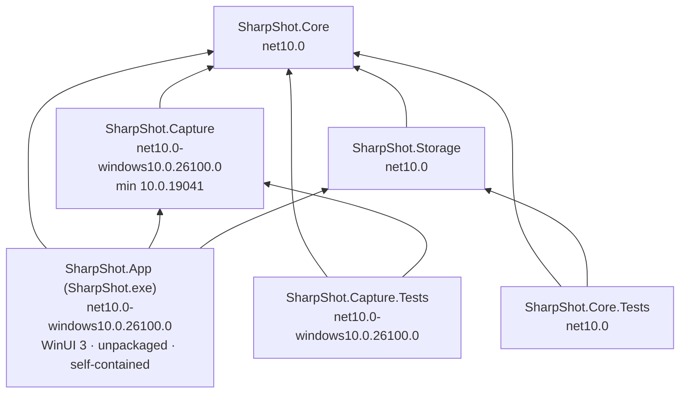

# Arquitetura da solução — SharpShot

> Detalhamento da camada canônica [`../ARCHITECTURE.md`](../ARCHITECTURE.md): responsabilidade de cada projeto, dependências NuGet reais, composição por DI, modelo de threads e onde cada regra mora. As decisões (o "porquê") estão em [`../DECISIONS.md`](../DECISIONS.md).
> Fontes: `SharpShot.slnx`, `Directory.Build.props`, `Directory.Packages.props`, os quatro `.csproj` e `obj/project.assets.json` (verificados em 04/nov/2026).
> Última atualização: 04/nov/2026 · Mantenedor: Victor Alves

## Ordem de leitura

1. Este arquivo — projetos, dependências, composição, threads.
2. [`fluxos.md`](fluxos.md) — diagramas de sequência (inicialização, captura, região, configurações, saída, erro).
3. [`recursos.md`](recursos.md) — ciclo de vida de device D3D, frame pool, bitmaps, handles Win32 e descartáveis.
4. [`erros.md`](erros.md) — `CaptureErrorKind`/`SaveErrorKind` → mensagem em pt-BR e ação.
5. [`../DECISIONS.md`](../DECISIONS.md) — ADR-01..15.

## Grafo de dependências



Regras que o grafo impõe (e que o compilador verifica): `Core` e `Storage` não têm TFM Windows, logo **não conseguem** referenciar WinRT; `Capture` não referencia `Storage` nem o contrário — só se falam por tipos do `Core`.

## Responsabilidades por projeto

### `SharpShot.Core` — contratos e lógica pura

| Pasta | Conteúdo | Regra |
|-------|----------|-------|
| `Models/` | `PixelRectangle`, `PixelBuffer`, `MonitorInfo`, `HotkeyBinding` (+ `HotkeyBindingJsonConverter`), `VirtualKeyNames`, `AppSettings`, `CaptureResult`/`CapturedFrame`/`SavedScreenshot`/`PathValidationResult` | Imutável onde possível (`record`); valida invariantes no construtor (`PixelBuffer`) |
| `Enums/` | `CaptureMode`, `ThemeMode`, `HotkeyModifiers`, `ResizeHandle`, `CaptureErrorKind`, `SaveErrorKind` | Primeiro membro com valor explícito; `HotkeyModifiers` = `MOD_*` |
| `Interfaces/` | `IMonitorService`, `IScreenCaptureService`, `IImageEncoder`, `IScreenshotStorage`, `ISettingsService` | Só tipos do `Core` nas assinaturas ([`../API.md`](../API.md)) |
| `Exceptions/` | `CaptureException`, `ScreenshotSaveException` | Sempre com `Kind` |
| `Services/` | `RegionMath`, `FileNaming`, `PathValidator` | Estáticos, puros, sem E/S (exceto `MakeUnique`, que recebe `Func<string,bool> fileExists`) |

### `SharpShot.Capture` — motor de captura

| Pasta | Conteúdo | Regra |
|-------|----------|-------|
| `Interop/` | `NativeMethods` (`DllImport`), `GraphicsCaptureInterop` (COM) | Toda falha nativa → `CaptureException`; ponteiros liberados em `finally` |
| `Graphics/` | `Direct3DDeviceFactory` | Único objeto nativo cacheado; `IDisposable` |
| `Services/` | `MonitorService`, `WindowsGraphicsCaptureService`, `CompositionSync` | Um frame por chamada; nada de estado entre capturas além do device |
| `Encoding/` | `PngImageEncoder` | Sem transformação de pixels |

Detalhe completo em [`../capture-engine/README.md`](../capture-engine/README.md).

### `SharpShot.Storage` — persistência local

| Pasta | Conteúdo | Regra |
|-------|----------|-------|
| `Configuration/` | `SettingsService`, `SettingsJsonContext` (source-gen) | Escrita atômica; backup de corrompido; normalização |
| `Services/` | `ScreenshotStorageService` | `FileMode.CreateNew`; erros classificados; arquivo parcial apagado |

Esquema e caminhos em [`../DATABASE.md`](../DATABASE.md).

### `SharpShot.App` — composição e UI

Estrutura **convencionada** (o que existe hoje: `Program.cs`, `App.xaml(.cs)`, `MainWindow.xaml(.cs)` placeholder, `app.manifest`, `Assets/`, `Components/LogoGeometry.cs`):

| Pasta | Conteúdo previsto |
|-------|-------------------|
| raiz | `Program.cs` (Main custom: `XamlCheckProcessRequirements`, `InitializeComWrappers`, `Application.Start` com `DispatcherQueueSynchronizationContext`), `App.xaml.cs` (DI, logging, instância única, ativação), `MainWindow.xaml` (barra de título custom + `NavigationView`) |
| `Views/` | `HomePage`, `SettingsPage`, `AboutPage`, `RegionOverlayWindow` |
| `ViewModels/` | `ObservableObject`, `RelayCommand`, `HomeViewModel`, `SettingsViewModel`, `AboutViewModel`, `RegionOverlayViewModel` |
| `Services/` | `ICaptureCoordinator`/`CaptureCoordinator` (orquestra captura → encoder → storage → notificação → status), `HotkeyService`, `TrayIconService`, `NotificationService`, `StartupService` (chave `Run`), `ThemeService`, `FileLoggerProvider`, `ErrorMessages` |
| `Interop/` | `RegisterHotKey`/`UnregisterHotKey`, `Shell_NotifyIconW`, `TrackPopupMenuEx`, `SetWindowDisplayAffinity`, `RegisterWindowMessage("TaskbarCreated")`, janela message-only (`HWND_MESSAGE`) |
| `Components/` | `LogoGeometry.cs` (gerado), controles reutilizáveis (card de ação, editor de atalho) |
| `Assets/` | `SharpShot.ico`, `Tray.ico`, `NotificationLogo.png`, tiles MSIX (gerados) |

## Dependências NuGet (reais)

Versões centralizadas em `Directory.Packages.props`; os `.csproj` referenciam sem versão.

| Pacote | Versão | Projetos | Papel |
|--------|--------|----------|-------|
| `Microsoft.Extensions.Logging.Abstractions` | 10.0.14 | Core, Capture, Storage | `ILogger<T>` sem provider |
| `Microsoft.Extensions.DependencyInjection` | 10.0.14 | App | Container |
| `Microsoft.Extensions.Logging` | 10.0.14 | App | `ILoggerFactory`, providers |
| `Microsoft.Extensions.Logging.Debug` | 10.0.14 | App | Output do VS |
| `Microsoft.WindowsAppSDK.WinUI` | 2.6.5 | App | XAML/WinUI 3 |
| `Microsoft.WindowsAppSDK.Foundation` | 2.6.5 | App | `AppInstance`, `AppNotificationManager`, bootstrap self-contained |
| `Microsoft.WindowsAppSDK.Runtime` | 2.6.5 | App | Runtime copiado (self-contained) |
| `Microsoft.NET.Test.Sdk` | 17.14.1 | testes | Host de testes |
| `xunit` | 2.9.3 | testes | Framework |
| `xunit.runner.visualstudio` | 3.1.5 | testes | Adapter |

Transitivos relevantes (verificados em `obj/project.assets.json` do App): `Microsoft.WindowsAppSDK.Base`, `.InteractiveExperiences` 2.6.5; `Microsoft.Windows.SDK.BuildTools` 10.0.26100.4654 e `.MSIX` 1.7.251221100 (ferramentas de build: `makepri`, `makeappx`); `Microsoft.Web.WebView2` 1.0.3719.77 (**vem com o WinUI, não é usado** — conferir se é copiado no publish); `Microsoft.Windows.SDK.NET.Ref` (projeções CsWinRT do TFM, também em `Capture`).

`Capture` e `Core.Tests`/`Capture.Tests` não referenciam o Windows App SDK diretamente; `Capture` usa só as projeções do TFM. **Nenhum pacote de rede, de UI de terceiros, de MVVM ou de binding D3D** — adicionar um exige ADR ([`../../CLAUDE.md`](../../CLAUDE.md)).

## Composição (DI) — convenção para o App

```csharp
services.AddLogging(b => b.AddDebug().AddProvider(new FileLoggerProvider(logsDir)));
services.AddSingleton<ISettingsService, SettingsService>();
services.AddSingleton<IScreenshotStorage, ScreenshotStorageService>();
services.AddSingleton<Direct3DDeviceFactory>();
services.AddSingleton<IMonitorService, MonitorService>();
services.AddSingleton<IScreenCaptureService, WindowsGraphicsCaptureService>();
services.AddSingleton<IImageEncoder, PngImageEncoder>();
services.AddSingleton<ICaptureCoordinator, CaptureCoordinator>();
services.AddSingleton<HotkeyService>(); services.AddSingleton<TrayIconService>(); // …
```

Tudo singleton: o app é um processo único com uma janela; não há escopo de requisição. `Direct3DDeviceFactory` é `IDisposable` e deve ser descartado no `Exit` ([`recursos.md`](recursos.md)).

## Modelo de threads

| Thread | O que roda | Regra |
|--------|------------|-------|
| **UI (DispatcherQueue do XAML)** | Janelas, páginas, overlays, handlers de botão | Nunca bloquear com `.Result`/`.Wait()`; `await` libera |
| **Janela message-only** | `WM_HOTKEY`, mensagens da bandeja, `TaskbarCreated` | Vive na thread da UI (criada por `CreateWindowEx` ali) ou em thread própria com message loop — **decisão do App, pendente**; o handler só enfileira a ação no `DispatcherQueue` |
| **Thread pool** | `CaptureMonitorAsync` (frame pool free-threaded), `EncodeAsync`, `SaveAsync`, `CompositionSync.WaitForCompositionAsync` | `Direct3DDeviceFactory` tem lock; `SettingsService` tem `SemaphoreSlim` |
| **COM / WinRT** | `AppNotificationManager` ativa por COM server; callbacks de notificação chegam em thread do pool | Voltar à UI com `DispatcherQueue.TryEnqueue` |

`CompositionSync.WaitForComposition()` é bloqueante (`DwmFlush`) — chamar pela versão `Async` a partir da UI.

## Onde cada regra mora

| Regra | Arquivo |
|-------|---------|
| "Nunca sobrescrever" | `ScreenshotStorageService.SaveAsync` (`FileMode.CreateNew`) + `FileNaming.MakeUnique` |
| "Seleção não atravessa monitores" | `RegionMath.FromDrag`/`ClampPoint` |
| "Alpha ignorado" | `WindowsGraphicsCaptureService.ReadPixelsAsync` (`ForceOpaque`) + `PngImageEncoder` (`BitmapAlphaMode.Ignore`) |
| "Hotkey precisa de modificador" | `HotkeyBinding.IsValid` + `SettingsService.Normalize` |
| "Caminho válido" | `PathValidator.ValidateDirectory` |
| "Device recriado após device-lost" | `WindowsGraphicsCaptureService.CaptureMonitorAsync` + `Direct3DDeviceFactory.Invalidate` |
| "Settings atômico" | `SettingsService.SaveAsync` (`.tmp` + `File.Move`) |
| "Janela do app fora da captura" | `CompositionSync` (Capture) + `SetWindowDisplayAffinity` (App, `WindowHost` e `RegionOverlayWindow`) |

---

Canônico: [`../ARCHITECTURE.md`](../ARCHITECTURE.md) · Fluxos: [`fluxos.md`](fluxos.md) · Recursos: [`recursos.md`](recursos.md) · Erros: [`erros.md`](erros.md)
