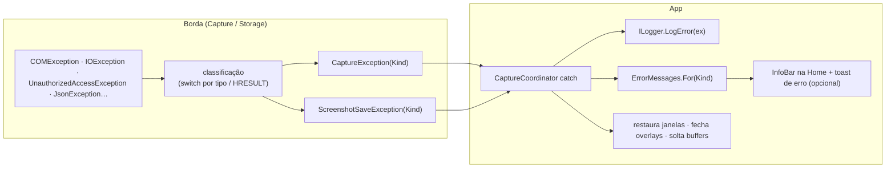

# Tratamento de erros — SharpShot

> Estratégia única para erros: o motor e o storage **classificam** (`CaptureErrorKind`, `SaveErrorKind`); o App **traduz** em uma tabela única de mensagens em pt-BR com ação sugerida; o log guarda a exceção original. Nenhuma `COMException`, `IOException` ou HRESULT chega à tela.
> Fontes: `CaptureErrorKind.cs`, `SaveErrorKind.cs`, `CaptureException.cs`, `WindowsGraphicsCaptureService.cs`, `Direct3DDeviceFactory.cs`, `MonitorService.cs`, `PngImageEncoder.cs`, `ScreenshotStorageService.cs`, `PathValidator.cs` (verificados). A classe `UserMessages` do App (`src/SharpShot.App/Services/UserMessages.cs`) implementa esta tabela; a exibição acontece na tela inicial (InfoBar de erro) e, com a janela oculta, em um toast de falha.
> Última atualização: 04/nov/2026 · Mantenedor: Victor Alves

## Princípios

1. **Classificar na borda.** O `catch` genérico (CA1031 desligado de propósito) existe só nos pontos de contato com o sistema: interop, encoder, E/S. Ali a exceção vira `CaptureException(Kind)` ou `ScreenshotSaveException(Kind)` com `InnerException` preservada.
2. **Uma tabela, uma voz.** Toda mensagem ao usuário sai de `ErrorMessages.For(kind)` no App: título curto, mensagem em pt-BR dizendo **o que aconteceu** e **o que fazer**. Sem HRESULT, sem stack, sem inglês.
3. **Nunca silencioso, nunca bloqueante.** Erro de captura/gravação aparece na linha de status da Home (`InfoBar` Error) e, se a notificação estiver ligada, em um toast de erro; nunca em `ContentDialog` modal — o usuário pode estar no meio de outra coisa.
4. **Estado sempre restaurado.** Depois de qualquer erro: janelas do app voltam ao estado anterior, overlays fecham, buffers são soltos, arquivo parcial é apagado.
5. **Log completo.** `LogError(ex, …)` com a exceção inteira (inclui `InnerException` e HRESULT) em `%LOCALAPPDATA%\SharpShot\logs`. É o que o usuário anexa na issue.
6. **`OperationCanceledException` passa.** Cancelamento (Esc, fechamento) não é erro; não gera mensagem.

## Fluxo



## `CaptureErrorKind` → mensagem

| Kind | Quando (código) | Título | Mensagem ao usuário | Ação sugerida na UI | Retry automático |
|------|-----------------|--------|---------------------|---------------------|------------------|
| `NotSupported` | `GraphicsCaptureSession.IsSupported()` falso ou lançou | Captura não disponível | "Este Windows ou esta sessão não permite captura de tela pelo Windows Graphics Capture. O SharpShot precisa do Windows 10 versão 2004 ou mais recente e de uma sessão de área de trabalho ativa." | Link para [`../distribution/compatibilidade.md`](../distribution/compatibilidade.md) na página Sobre | não |
| `NoMonitor` | `EnumDisplayMonitors` falhou/vazio; `CreateForMonitor` falhou; `item.Size` vazio | Monitor não encontrado | "Não foi possível acessar o monitor para capturar. Se um monitor acabou de ser conectado ou desconectado, tente novamente." | Botão **Tentar novamente** | não (o usuário tenta) |
| `DeviceFailure` | `D3D11CreateDevice` falhou em hardware e em WARP; `CreateDirect3D11DeviceFromDXGIDevice` falhou | Falha no dispositivo gráfico | "O SharpShot não conseguiu inicializar o dispositivo gráfico necessário para a captura. Atualize o driver de vídeo e tente novamente." | **Tentar novamente**; link para logs | não |
| `Timeout` | Nenhum frame em 5 s | A captura demorou demais | "O Windows não entregou a imagem da tela a tempo. Tente novamente; se persistir, feche aplicativos em tela cheia ou reinicie o SharpShot." | **Tentar novamente** | não (um `Timeout` costuma repetir) |
| `Cancelled` | `CancellationToken` cancelado | — | *(sem mensagem — cancelamento é silencioso)* | — | — |
| `AccessDenied` | reservado (nenhum caminho atual) | Acesso negado | "O Windows negou o acesso à captura de tela. Verifique as configurações de privacidade do sistema." | — | não |
| `Unknown` | reservado | Erro inesperado | "Ocorreu um erro inesperado ao capturar a tela. Os detalhes foram gravados no log." | **Abrir pasta de logs** | não |

Retry **interno** que já existe no motor e não gera mensagem: device perdido (`DXGI_ERROR_DEVICE_REMOVED`/`RESET`) → device recriado e **uma** nova tentativa; só a segunda falha vira erro ao usuário (com o `Kind` da segunda).

## `SaveErrorKind` → mensagem

| Kind | Quando (código) | Título | Mensagem ao usuário | Ação sugerida na UI | Retry automático |
|------|-----------------|--------|---------------------|---------------------|------------------|
| `InvalidPath` | `PathValidator` reprovou (vazio, caracteres inválidos, relativo, nome reservado, termina em espaço/ponto); `PathTooLongException`, `NotSupportedException`, `ArgumentException` | Pasta inválida | "A pasta de salvamento não é válida: {detalhe}." — o detalhe é o `PathValidationResult.Error` já em pt-BR, ex.: *"Informe um caminho completo (por exemplo, C:\Imagens\SharpShot)."* | **Abrir Configurações** (seção Salvamento) | não |
| `DirectoryNotFound` | `DirectoryNotFoundException` (unidade/pasta sumiu entre validar e gravar) | Pasta não encontrada | "A pasta {pasta} não existe mais ou a unidade foi removida. Escolha outra pasta nas Configurações." | **Abrir Configurações** | não |
| `PermissionDenied` | `UnauthorizedAccessException` | Sem permissão | "O SharpShot não tem permissão para gravar em {pasta}. Escolha outra pasta ou ajuste as permissões." | **Abrir Configurações** | não |
| `DiskFull` | `IOException` com `ERROR_DISK_FULL` / `ERROR_HANDLE_DISK_FULL` | Disco cheio | "Não há espaço livre suficiente em {unidade} para salvar a captura. Libere espaço ou escolha outra pasta." | **Abrir Configurações** | não |
| `FileLocked` | `IOException` com `ERROR_SHARING_VIOLATION` / `ERROR_LOCK_VIOLATION` após 3 tentativas com sufixo `_x` | Arquivo em uso | "Outro programa está bloqueando a gravação em {pasta}. Feche programas que usam essa pasta (sincronização, antivírus) e tente novamente." | **Tentar novamente** | sim, 3× com nome novo, **antes** de virar erro |
| `EncodingFailed` | `PngImageEncoder` (`COMException`, `InvalidOperationException`, `ArgumentException`, `OutOfMemoryException`) | Falha ao gerar o PNG | "Não foi possível converter a captura para PNG. Tente novamente; se persistir, reinicie o SharpShot." | **Tentar novamente** | não |
| `Unknown` | qualquer outra (`IOException` sem HRESULT conhecido, `MakeUnique` esgotou 1000 sufixos…) | Erro ao salvar | "Ocorreu um erro inesperado ao salvar a captura em {pasta}. Os detalhes foram gravados no log." | **Abrir pasta de logs** | não |

Placeholders `{pasta}`, `{unidade}` e `{detalhe}` são preenchidos pelo App; a pasta mostrada é a **resolvida** (`ResolveDirectory`), não a string crua do `settings.json`.

## Validação de caminho na UI (antes de salvar)

A página Configurações chama `IScreenshotStorage.ValidateDirectory(texto)` a cada edição (debounce) e mostra o `Error` de `PathValidator` inline, sem esperar uma captura falhar. Mensagens existentes no código:

- "O caminho está vazio." *(só em `PathValidator` direto; na UI, vazio = padrão e é válido)*
- "O caminho contém caracteres inválidos."
- "Informe um caminho completo (por exemplo, C:\Imagens\SharpShot)."
- "O nome de pasta "{segmento}" contém caracteres inválidos."
- ""{segmento}" é um nome reservado do Windows."
- "O nome de pasta "{segmento}" não pode terminar com espaço ou ponto."

## Outros erros do App (convenção)

| Situação | Tratamento |
|----------|------------|
| Conflito de atalho (`ERROR_HOTKEY_ALREADY_REGISTERED`, 1409) | `InfoBar` Warning na seção Atalhos: "O atalho {atalho} já está em uso por outro aplicativo. Escolha outra combinação." O atalho anterior é restaurado. Na inicialização, se um dos padrões conflitar, o app abre com o `InfoBar` visível e o outro atalho funcionando |
| `settings.json` corrompido | Silencioso para o usuário (backup + padrões); linha no log. Opcional: `InfoBar` informativo na primeira abertura: "As configurações foram redefinidas porque o arquivo anterior estava danificado (cópia salva em …)." — **decisão pendente** |
| `AppNotificationManager.Register()` falhou | Sem toast; captura segue; log em `Warning`; toggle "Mostrar notificação" permanece, com texto auxiliar "Notificações indisponíveis nesta sessão" — **pendente de decisão** |
| Falha ao escrever a chave `Run` | `InfoBar` Error na seção Geral: "Não foi possível alterar a inicialização com o Windows." Toggle volta ao estado real |
| Exceção não tratada na UI | `Application.UnhandledException`: log + `InfoBar` genérico; o app **não** encerra por erro de captura |

## Logs (o que cada erro grava)

```text
2026-11-04 14:32:07.583 [Error] CaptureCoordinator: Capture failed (Timeout). SharpShot.Core.Exceptions.CaptureException: No frame arrived from Windows Graphics Capture within 5 seconds. ---> System.TimeoutException …
2026-11-04 14:35:12.004 [Warning] Direct3DDeviceFactory: Hardware D3D11 device creation failed (0x887A0004); falling back to WARP.
2026-11-04 14:36:40.118 [Error] CaptureCoordinator: Save failed (DiskFull) at C:\Users\x\Pictures\SharpShot. SharpShot.Core.Exceptions.ScreenshotSaveException: Could not save '…': There is not enough space on the disk. ---> System.IO.IOException (0x80070070)
```

Formato do logger de arquivo (`FileLoggerProvider`): `yyyy-MM-dd HH:mm:ss.fff [NÍVEL] Categoria: mensagem`, um arquivo por dia em `%LOCALAPPDATA%\SharpShot\logs\sharpshot-AAAAMMDD.log`, 7 arquivos mantidos.

## Testes relacionados

- `ScreenshotStorageService`: `UnauthorizedAccessException` → `PermissionDenied`; `IOException` com `0x80070070` → `DiskFull`; pasta inválida → `InvalidPath` sem tocar o disco; arquivo parcial apagado após falha.
- `PngImageEncoder`: buffer inválido → `EncodingFailed` (não `ArgumentException` crua).
- `ErrorMessages.For` cobre **todos** os valores dos dois enums (teste com `Enum.GetValues`).

---

Responsabilidades: [`README.md`](README.md) · Fluxos: [`fluxos.md`](fluxos.md) · Contratos: [`../API.md`](../API.md) · Persistência: [`../DATABASE.md`](../DATABASE.md)
