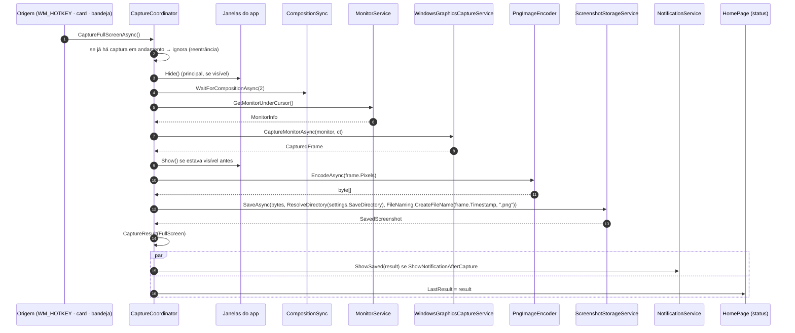
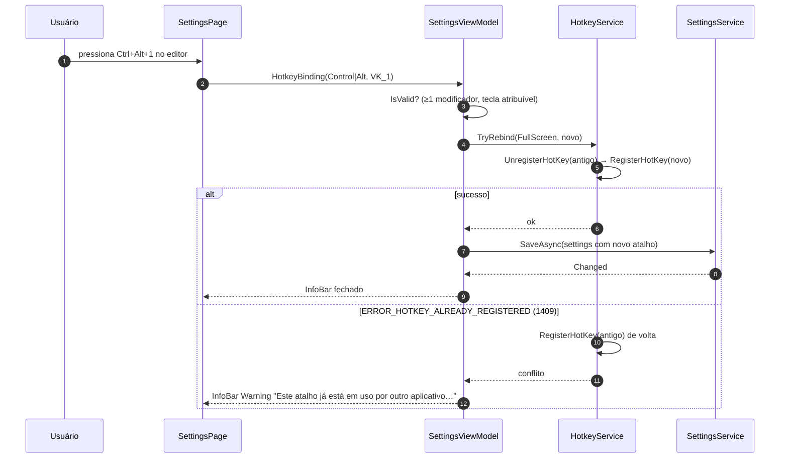

# Fluxos de execução — SharpShot

> Diagramas de sequência dos fluxos do app: inicialização, captura de tela inteira, seleção de região, mudança de configurações, erro e saída. Os participantes de `Capture`/`Storage`/`Core` são classes **verificadas**; os do `App` (`CaptureCoordinator`, `HotkeyService`, `TrayIconService`, `NotificationService`, `RegionOverlayWindow`) estão implementados em `src/SharpShot.App/Services` e `Views`.
> Fontes: código de `src/` · [`README.md`](README.md) · [`../capture-engine/README.md`](../capture-engine/README.md).
> Última atualização: 04/nov/2026 · Mantenedor: Victor Alves

## 1. Inicialização

```mermaid
sequenceDiagram
    autonumber
    participant OS as Windows
    participant P as Program.Main
    participant App as App
    participant DI as ServiceProvider
    participant Set as SettingsService
    participant HK as HotkeyService
    participant Tray as TrayIconService
    participant N as NotificationService
    participant W as MainWindow

    OS->>P: SharpShot.exe [--minimized]
    P->>P: XamlCheckProcessRequirements · InitializeComWrappers
    P->>App: Application.Start (DispatcherQueueSynchronizationContext)
    App->>App: AppInstance.FindOrRegisterForKey("SharpShot")
    alt já existe outra instância
        App->>OS: RedirectActivationToAsync(instância existente)
        App-->>OS: encerra
    end
    App->>DI: registra serviços (singletons) + logging (Debug + arquivo)
    App->>Set: LoadAsync()
    Set-->>App: AppSettings (ou padrões / backup de corrompido)
    App->>HK: Register(FullScreenHotkey, RegionHotkey)
    HK-->>App: ok ou conflito (ERROR_HOTKEY_ALREADY_REGISTERED)
    App->>Tray: Add() (Shell_NotifyIcon NIM_ADD)
    App->>N: Register() (AppNotificationManager; tolera falha)
    App->>App: StartupService.SyncRunKey(settings.StartWithWindows)
    alt --minimized ausente
        App->>W: Activate() (tema aplicado; WDA_EXCLUDEFROMCAPTURE)
    else --minimized
        App->>App: fica só na bandeja
    end
```

## 2. Captura de tela inteira



Observação: o `Hide()`/`Show()` da janela principal só acontece quando ela está visível; disparo pela bandeja com a janela escondida não mexe nela. O overlay nunca está aberto neste fluxo.

## 3. Seleção de região

```mermaid
sequenceDiagram
    autonumber
    participant Src as Origem (WM_HOTKEY · card · bandeja)
    participant CC as CaptureCoordinator
    participant Sync as CompositionSync
    participant Mon as MonitorService
    participant Cap as WindowsGraphicsCaptureService
    participant OV as RegionOverlayWindow ×N
    participant RM as RegionMath
    participant PB as PixelBuffer
    participant Enc as PngImageEncoder
    participant St as ScreenshotStorageService

    Src->>CC: CaptureRegionAsync()
    CC->>CC: esconde a principal · WaitForCompositionAsync(2)
    CC->>Mon: GetMonitors()
    loop cada monitor
        CC->>Cap: CaptureMonitorAsync(monitor)
        Cap-->>CC: CapturedFrame
    end
    CC->>OV: abre um overlay por monitor (fundo = frame; Bounds físicos; WDA_EXCLUDEFROMCAPTURE)
    loop interação
        OV->>RM: FromDrag / HitTest / Resize / Move (clamp a monitor.Bounds)
        RM-->>OV: PixelRectangle (físico)
        OV->>OV: redesenha máscara, borda, handles, badge
    end
    alt Enter / Capturar
        OV-->>CC: (monitor, PixelRectangle)
        CC->>OV: fecha todos
        CC->>PB: frames[monitor].Pixels.Crop(rect.RelativeTo(monitor.Bounds))
        PB-->>CC: PixelBuffer recortado
        CC->>Enc: EncodeAsync
        CC->>St: SaveAsync(…)
        CC->>CC: CaptureResult(Region) → toast + status
    else Esc / Cancelar
        OV-->>CC: cancelado
        CC->>OV: fecha todos — nada gravado
    end
    CC->>CC: libera os N PixelBuffers
```

## 4. Mudança de atalho (Configurações)



**Restaurar padrões** segue o mesmo caminho com `HotkeyBinding.DefaultFullScreen`/`DefaultRegion`. Outros campos (pasta, toggles, tema) vão direto para `SaveAsync` e os serviços interessados reagem ao evento `Changed` (`ThemeService`, `StartupService`).

## 5. Erro de captura ou gravação

```mermaid
sequenceDiagram
    autonumber
    participant CC as CaptureCoordinator
    participant Cap as WindowsGraphicsCaptureService
    participant St as ScreenshotStorageService
    participant EM as ErrorMessages
    participant Home as HomePage
    participant Log as ILogger

    CC->>Cap: CaptureMonitorAsync
    Cap--xCC: CaptureException(Kind=Timeout)
    CC->>Log: LogError(ex) com InnerException
    CC->>EM: For(CaptureErrorKind.Timeout)
    EM-->>CC: (título, mensagem, ação) em pt-BR
    CC->>Home: LastError = mensagem (InfoBar Error)
    Note over CC: janelas restauradas; overlays fechados; nenhum arquivo parcial
    CC->>St: (em outra captura) SaveAsync
    St--xCC: ScreenshotSaveException(Kind=DiskFull)
    CC->>EM: For(SaveErrorKind.DiskFull)
    CC->>Home: mensagem + ação "Libere espaço ou escolha outra pasta"
```

Política completa (quando tentar de novo, quando abrir Configurações): [`erros.md`](erros.md).

## 6. Fechar e Sair

```mermaid
sequenceDiagram
    autonumber
    participant U as Usuário
    participant W as MainWindow
    participant App as App
    participant HK as HotkeyService
    participant Tray as TrayIconService
    participant N as NotificationService
    participant D3D as Direct3DDeviceFactory

    U->>W: clica no X
    alt MinimizeToTray = true
        W->>W: cancela Closing · Hide()
    else
        W->>App: Exit()
    end
    U->>Tray: menu → Sair
    Tray->>App: Exit()
    App->>HK: UnregisterAll()
    App->>Tray: Remove() (NIM_DELETE)
    App->>N: (mantém registro — é por usuário; Unregister só na desinstalação)
    App->>D3D: Dispose()
    App->>App: ServiceProvider.Dispose() · flush do logger
```

## 7. Instância única e `--minimized`

Uma segunda execução chama `AppInstance.FindOrRegisterForKey("SharpShot")`; se a chave já pertence a outro processo, redireciona a ativação e encerra. A primeira instância recebe `Activated` e mostra/ativa a janela. `--minimized` (vindo da chave `Run`) suprime o `Activate()` inicial — o app nasce na bandeja.

---

Responsabilidades: [`README.md`](README.md) · Recursos: [`recursos.md`](recursos.md) · Erros: [`erros.md`](erros.md) · Motor: [`../capture-engine/README.md`](../capture-engine/README.md)
