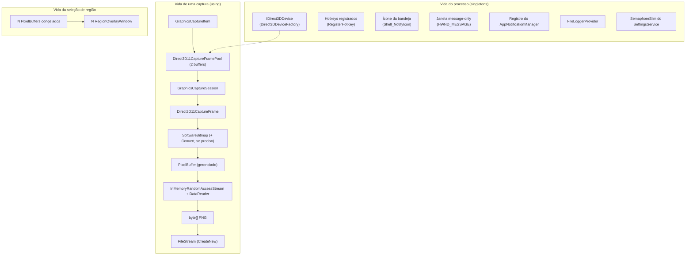
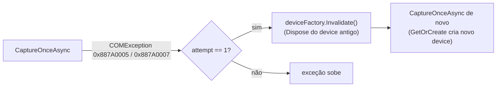

# Gerenciamento de recursos — SharpShot

> Ciclo de vida de tudo que não é coletado pelo GC sozinho: device Direct3D, frame pool, sessão de captura, frames, `SoftwareBitmap`, streams WinRT, ponteiros COM, handles Win32 (hotkeys, bandeja, janela message-only) e os buffers de pixel grandes. Regra: **quem cria, descarta — no mesmo método, em `using`/`finally`**.
> Fontes: `Direct3DDeviceFactory.cs`, `WindowsGraphicsCaptureService.cs`, `PngImageEncoder.cs`, `GraphicsCaptureInterop.cs`, `SettingsService.cs`, `ScreenshotStorageService.cs` (verificados) · App (`WindowHost.cs`, `RegionOverlayWindow.xaml.cs`, `HotkeyService.cs`, `TrayIconService.cs`, `NotificationService.cs`, `MessageWindow.cs`).
> Última atualização: 04/nov/2026 · Mantenedor: Victor Alves

## Mapa de recursos

## Recursos nativos do motor (`Capture`) — verificado

| Recurso | Criado em | Descartado em | Como | Observação |
|---------|-----------|---------------|------|------------|
| `ID3D11Device`, `ID3D11DeviceContext`, `IDXGIDevice`, `IInspectable` intermediários | `Direct3DDeviceFactory.TryCreate` | mesmo método, `finally` aninhados | `Marshal.Release` em cada ponteiro, na ordem inversa | Só o `IDirect3DDevice` WinRT sobrevive (via `MarshalInterface<T>.FromAbi`, que faz `AddRef`) |
| `IDirect3DDevice` (cache) | `GetOrCreate()` (lazy, sob lock) | `Invalidate()` (device-lost) ou `Dispose()` (saída do app) | `IDisposable.Dispose()` | **Único recurso nativo de longa vida.** O App deve chamar `Dispose()` do factory no `Exit` |
| Ponteiro ABI do `GraphicsCaptureItem` | `IGraphicsCaptureItemInterop.CreateForMonitor` | `finally` em `CreateItemForMonitor` | `Marshal.Release(abi)` depois de `FromAbi` | — |
| `GraphicsCaptureItem` | `CaptureOnceAsync` | fim do método (GC/WinRT) | referência solta | Não é `IDisposable`; a sessão o segura só enquanto vive |
| `Direct3D11CaptureFramePool` | `CreateFreeThreaded(device, B8G8R8A8, **2**, size)` | `using var framePool` | `Dispose()` | 2 buffers: o DWM nunca espera o consumidor |
| `GraphicsCaptureSession` | `framePool.CreateCaptureSession(item)` | `using var session` | `Dispose()` — para a captura | Descartada **antes** do pool (ordem de declaração inversa do `using`) |
| Handler `FrameArrived` | `+=` antes de `StartCapture` | `-=` no `finally` | — | Evita callback após o descarte |
| `Direct3D11CaptureFrame` (1º) | `TryGetNextFrame()` no handler | `using (captured)` após ler os pixels | `Dispose()` | Frames extras que o handler receber depois do primeiro são descartados no próprio handler (`TrySetResult` falso → `frame.Dispose()`) |
| `SoftwareBitmap` | `CreateCopyFromSurfaceAsync` | `using var bitmap` | `Dispose()` | Se houve `SoftwareBitmap.Convert`, o resultado é descartado no `finally` (`!ReferenceEquals(source, bitmap)`) |
| `InMemoryRandomAccessStream`, `DataReader` | `PngImageEncoder.EncodeAsync` | `using` | `Dispose()` | O `byte[]` resultante é gerenciado |
| `BitmapEncoder` | `CreateAsync` | fim do método | — | Não é `IDisposable` no WinRT; libera com o stream |

Ordem de descarte em `CaptureOnceAsync`, garantida pela pilha de `using`: `captured` (frame) → handler removido → `session` → `framePool`. O device fica.

### Device perdido

O pool e a sessão da tentativa falha já foram descartados pelos `using` quando a exceção saiu.

## Recursos gerenciados grandes

| Recurso | Tamanho | Vida | Regra |
|---------|---------|------|-------|
| `PixelBuffer` de um frame | `W × H × 4` bytes (1080p ≈ 8 MB; 4K ≈ 33 MB; 5K ≈ 59 MB) | Até o PNG ser codificado | Não reter em campo de serviço; passar adiante e soltar |
| `PixelBuffer` recortado (`Crop`) | tamanho da seleção | Idem | `Crop` sempre copia — o original pode ser solto antes de codificar |
| N frames congelados (região) | N × acima | Enquanto os overlays estão abertos | O `CaptureCoordinator` solta todos ao fechar os overlays (sucesso ou cancelamento); nunca cacheia entre seleções |
| `byte[]` do PNG | 10–40 % do buffer (estimativa, **não medida**) | Até `SaveAsync` terminar | — |
| Bitmap de fundo do overlay (`WriteableBitmap`/`SoftwareBitmapSource`) | igual ao frame | Vida do overlay | Criado do `PixelBuffer`; descartado com a janela |

Buffers acima de 85 KB vão para o LOH; o GC os coleta na Gen2. Para um app interativo isso é aceitável — **não** chamar `GC.Collect()` manualmente; se a medição (pendente) mostrar pressão, a alternativa é `ArrayPool<byte>.Shared` no `PixelBuffer.Create`, o que exigiria `PixelBuffer : IDisposable`.

## Recursos do App

| Recurso | Criado | Descartado | Falha comum a evitar |
|---------|--------|------------|----------------------|
| Janela message-only (`CreateWindowEx` com `HWND_MESSAGE`) | início | `DestroyWindow` no `Exit` | `WndProc` delegate coletado pelo GC → `GC.KeepAlive`/campo estático |
| Hotkeys (`RegisterHotKey` ids 1 e 2) | início e ao mudar atalho | `UnregisterHotKey` no `Exit` e antes de re-registrar | Sair sem desregistrar deixa o atalho "preso" até o processo morrer (o Windows limpa ao fim do processo, mas não em crash de UI com processo vivo) |
| Ícone da bandeja (`NIM_ADD`) | início e em `TaskbarCreated` | `NIM_DELETE` no `Exit` | Ícone fantasma até o mouse passar por cima — sempre `NIM_DELETE` |
| `HICON` do `Tray.ico` | `LoadImage`/`ExtractIcon` | `DestroyIcon` no `Exit` | Vazamento de GDI handle por reinício do Explorer — reutilizar o mesmo `HICON` |
| `HMENU` do menu popup | a cada abertura (`CreatePopupMenu`) | `DestroyMenu` após `TrackPopupMenuEx` | Criar uma vez e esquecer de destruir |
| Registro do `AppNotificationManager` | `Register()` no início | **não** desregistrar no `Exit` (é por usuário e persistente); `Unregister()` só na desinstalação | Desregistrar a cada saída apaga notificações já na Central |
| `RegionOverlayWindow` ×N | a cada seleção | `Close()` em sucesso ou cancelamento; nunca reaproveitar entre seleções | Overlay órfão em um monitor desconectado durante a seleção → tratar `DisplayArea` mudando |
| `FileLoggerProvider` | início | `Dispose()` (flush) no `Exit` | Última linha do log perdida em saída abrupta |
| `ServiceProvider` | início | `Dispose()` no `Exit` — descarta `Direct3DDeviceFactory` e demais `IDisposable` singletons | — |

## Arquivos e handles de E/S (`Storage`) — verificado

| Recurso | Padrão |
|---------|--------|
| `FileStream` de gravação do PNG | `await using`, `FileMode.CreateNew`, `FileShare.None`, 64 KiB, `useAsync: true`; `FlushAsync` antes de fechar |
| Arquivo parcial após falha | `TryDeletePartialFile` (best-effort, logado) |
| `settings.json.tmp` | `await using`; `File.Move(overwrite: true)` — se o processo morrer antes do `Move`, o `.tmp` fica e é sobrescrito na próxima gravação; o `settings.json` anterior permanece íntegro |
| `SemaphoreSlim(1,1)` | `WaitAsync`/`Release` em `finally`; o evento `Changed` dispara **fora** do lock para evitar deadlock se um handler salvar de novo |

## Checklist de revisão

1. Todo objeto WinRT/COM `IDisposable` está em `using` ou descartado em `finally`?
2. Todo ponteiro bruto (`nint`) recebido de COM tem `Marshal.Release` em `finally`?
3. Nenhum serviço singleton retém `PixelBuffer`/`SoftwareBitmap`/frame em campo?
4. Handler de evento nativo (`FrameArrived`, `WndProc`) é removido/mantido vivo corretamente?
5. O `Exit` do App desregistra hotkeys, remove o ícone, destrói `HICON`/`HMENU`/janela message-only, descarta o `ServiceProvider` e dá flush no logger?
6. **Pendente:** medir memória após 100 capturas (tela inteira e região) e registrar em [`../project-context/requisitos.md`](../project-context/requisitos.md) (RNF-06).

---

Responsabilidades: [`README.md`](README.md) · Fluxos: [`fluxos.md`](fluxos.md) · Interop: [`../capture-engine/interop.md`](../capture-engine/interop.md)
