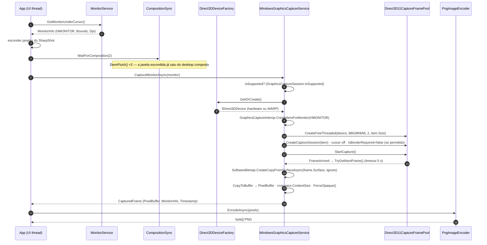

# Capture Engine — SharpShot

> Como o SharpShot tira a foto da tela: Windows Graphics Capture (WGC) sobre Direct3D 11, frame copiado para memória gerenciada e gravado em PNG sem perdas. Esta pasta documenta o projeto [`src/SharpShot.Capture`](../../src/SharpShot.Capture) e a parte da UI que depende dele.
> Fontes: código de `SharpShot.Capture` (verificado) · [`../ARCHITECTURE.md`](../ARCHITECTURE.md) · [`../DECISIONS.md`](../DECISIONS.md) (ADR-02, ADR-03, ADR-04, ADR-10).
> Última atualização: 04/nov/2026 · Mantenedor: Victor Alves

## Ordem de leitura

1. Este arquivo — visão geral e fluxo de captura.
2. [`interop.md`](interop.md) — as chamadas Win32/COM que o .NET não expõe sozinho.
3. [`dpi-e-monitores.md`](dpi-e-monitores.md) — DPI, PerMonitorV2, desktop virtual e coordenadas negativas.
4. [`regiao.md`](regiao.md) — seleção de região sobre o frame congelado.
5. [`hdr.md`](hdr.md) — SDR, HDR e por que o PNG é 8-bit.
6. [`png.md`](png.md) — codificação sem perdas pelo WIC.
7. [`limitacoes.md`](limitacoes.md) — o que o motor não faz (ainda).

## Por que Windows Graphics Capture

| Técnica | O que entrega | Por que não (ou por que sim) |
|---------|---------------|------------------------------|
| GDI (`BitBlt` do DC da tela) | Pixels do DC | Falha ou retorna preto com conteúdo DirectX/fullscreen exclusivo e com camadas aceleradas; não é "o que o DWM compõe" |
| Desktop Duplication (DXGI) | Frames da saída do adaptador | Exige tratar frames "sem mudança", rotação de saída e perde acesso em trocas de desktop seguro; API mais baixa do que o necessário para captura única |
| **Windows Graphics Capture** (`Windows.Graphics.Capture`) | Composição do DWM de um monitor ou janela, em superfície D3D11 | **Escolhido (ADR-02).** DPI-exato, funciona com apps DirectX e fullscreen, respeita exclusão de janelas (`WDA_EXCLUDEFROMCAPTURE`), API estável desde o Windows 10 1903 e evoluída no 2004+ (`IsCursorCaptureEnabled`, `IsBorderRequired`) |

Custo aceito: o frame chega como **SDR 8-bit** mesmo em monitor HDR ([`hdr.md`](hdr.md)) e o WGC precisa de uma **sessão de desktop** (não funciona em sessão de serviço nem em alguns cenários de RDP sem desktop — a propriedade `IsSupported` reporta isso).

## Peças do motor (`src/SharpShot.Capture`)

| Arquivo | Papel | Status |
|---------|-------|--------|
| `Interop/NativeMethods.cs` | `DllImport` de `user32` (monitores, cursor), `shcore` (`GetDpiForMonitor`), `dwmapi` (`DwmFlush`), `d3d11` (`D3D11CreateDevice`, `CreateDirect3D11DeviceFromDXGIDevice`); structs `RECT`/`POINT`/`MONITORINFOEXW`; constantes DXGI | implementado |
| `Interop/GraphicsCaptureInterop.cs` | `IGraphicsCaptureItemInterop` (COM) → `GraphicsCaptureItem` a partir de um `HMONITOR`, sem picker | implementado |
| `Graphics/Direct3DDeviceFactory.cs` | Cria e cacheia o `IDirect3DDevice` WinRT: hardware → fallback WARP; `Invalidate()` após device-removed | implementado |
| `Services/MonitorService.cs` | `IMonitorService`: enumeração, DPI efetivo, monitor sob o cursor, desktop virtual | implementado |
| `Services/WindowsGraphicsCaptureService.cs` | `IScreenCaptureService`: captura única de um monitor em BGRA8 opaco | implementado |
| `Services/CompositionSync.cs` | `DwmFlush` ×2 para garantir que uma janela escondida já saiu da composição antes da captura | implementado |
| `Encoding/PngImageEncoder.cs` | `IImageEncoder`: PNG sem perdas via `Windows.Graphics.Imaging.BitmapEncoder` (WIC) | implementado |

O projeto tem `AllowUnsafeBlocks=true` (reservado para interop); hoje nenhum bloco `unsafe` é usado — a cópia de pixels passa por `SoftwareBitmap.CopyToBuffer` (ADR-03).

## Fluxo de captura de um monitor

Pontos que o diagrama não mostra e o código garante:

- **Um frame, depois descarta.** O `TaskCompletionSource` aceita só o primeiro frame; qualquer outro que chegue é descartado com `Dispose()`. O pool tem **2 buffers** para o DWM nunca precisar esperar o consumidor.
- **Free-threaded.** `CreateFreeThreaded` dispensa um `DispatcherQueue`: a captura pode ser aguardada de qualquer thread, o que simplifica chamar o serviço a partir do handler do hotkey.
- **Device perdido.** `COMException` com `DXGI_ERROR_DEVICE_REMOVED` ou `DXGI_ERROR_DEVICE_RESET` na primeira tentativa → `Invalidate()` no factory e **uma** nova tentativa com device novo.
- **Timeout de 5 s** → `CaptureException(CaptureErrorKind.Timeout)`; cancelamento → `CaptureErrorKind.Cancelled`.
- **`ContentSize` menor que a superfície** (modo de vídeo acabou de mudar) → o buffer é recortado para o conteúdo real em vez de gravar borda lixo.
- **Alpha forçado a 255.** Captura de desktop é opaca por definição; o PNG ignora alpha de qualquer forma ([`png.md`](png.md)).

## Fluxo de seleção de região

Mesmo pipeline, com uma etapa a mais entre o frame e o encoder: o frame congelado vira fundo do overlay, o usuário desenha o retângulo e `PixelBuffer.Crop` recorta. Detalhado em [`regiao.md`](regiao.md).

## Exclusão das janelas do SharpShot

Duas defesas, nessa ordem:

1. **`SetWindowDisplayAffinity(hwnd, WDA_EXCLUDEFROMCAPTURE)`** nas janelas do SharpShot (principal e overlays) — o DWM as omite da composição que o WGC vê. *(App: `WindowHost` e `RegionOverlayWindow`; `SHARPSHOT_ALLOW_SELF_CAPTURE=1` desliga só para desenvolvimento.)*
2. **Esconder a janela principal + `CompositionSync.WaitForComposition()`** antes de iniciar a sessão — cobre o caso em que a afinidade não é honrada. A dupla defesa custa dois frames de composição e evita uma classe inteira de "tirei print do próprio SharpShot".

`DwmFlush` retorna erro quando o DWM não está rodando (sessão legada); nesse caso o `CompositionSync` cai para um `Thread.Sleep(16)` por frame.

## Erros que o motor classifica

| `CaptureErrorKind` | Quando | Origem no código |
|--------------------|--------|------------------|
| `NotSupported` | `GraphicsCaptureSession.IsSupported()` falso ou lançou | `WindowsGraphicsCaptureService.CaptureMonitorAsync` |
| `NoMonitor` | `EnumDisplayMonitors` falhou, lista vazia, `CreateForMonitor` falhou ou `item.Size` vazio | `MonitorService`, `CaptureOnceAsync` |
| `DeviceFailure` | `D3D11CreateDevice` falhou em hardware **e** em WARP | `Direct3DDeviceFactory.Create` |
| `Timeout` | Nenhum frame em 5 s | `CaptureOnceAsync` |
| `Cancelled` | `CancellationToken` cancelado durante a espera | `CaptureOnceAsync` |
| `AccessDenied` | Reservado (nenhum caminho do código atual o lança) | — |
| `Unknown` | Reservado | — |

Mensagens em pt-BR para o usuário e política de retry: [`../architecture/erros.md`](../architecture/erros.md).

## O que ainda não está no código

- A UI que chama o motor (hotkey → captura → encoder → storage → toast) está implementada em `SharpShot.App` (`CaptureCoordinator`) e validada na máquina do autor.
- Testes de `tests/SharpShot.Capture.Tests` (round-trip PNG byte a byte, enumeração de monitores, captura de integração pulada quando WGC não é suportado): **35 testes, todos verdes**.

---

Arquitetura geral: [`../ARCHITECTURE.md`](../ARCHITECTURE.md) · Recursos nativos e descarte: [`../architecture/recursos.md`](../architecture/recursos.md) · Decisões: [`../DECISIONS.md`](../DECISIONS.md)
