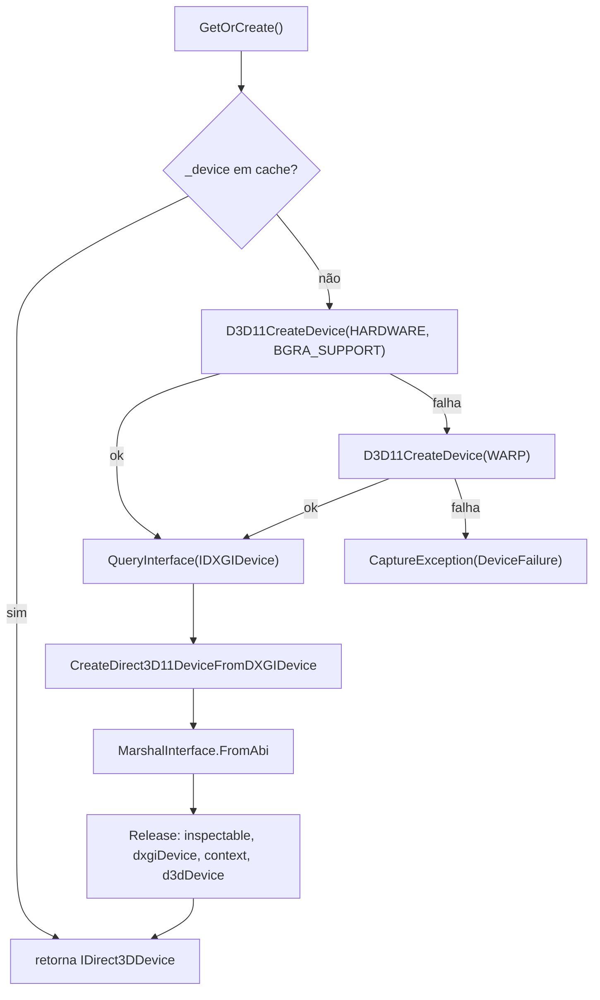

# Interop Win32 / COM — Capture Engine

> As chamadas nativas que o motor usa, por que cada uma existe e o que acontece se falhar. Tudo aqui está em [`src/SharpShot.Capture/Interop/`](../../src/SharpShot.Capture/Interop) e em [`Graphics/Direct3DDeviceFactory.cs`](../../src/SharpShot.Capture/Graphics/Direct3DDeviceFactory.cs).
> Fontes: código verificado · [`README.md`](README.md) · [ADR-03](../DECISIONS.md#adr-03--softwarebitmapcreatecopyfromsurfaceasync-em-vez-de-binding-d3d11).
> Última atualização: 04/nov/2026 · Mantenedor: Victor Alves

## Princípio

O .NET 10 com TFM `net10.0-windows10.0.26100.0` já projeta todo o WinRT (`Windows.Graphics.Capture`, `Windows.Graphics.Imaging`, `Windows.Graphics.DirectX.Direct3D11`) via CsWinRT (pacote `Microsoft.Windows.SDK.NET.Ref`, que vem com o targeting pack). O que falta — e o que este arquivo documenta — são as **três pontes** que o WinRT não oferece de forma gerenciada:

1. Criar um `GraphicsCaptureItem` para um monitor **sem o picker** (`IGraphicsCaptureItemInterop`).
2. Criar o `IDirect3DDevice` WinRT a partir de um device D3D11 clássico (`D3D11CreateDevice` + `CreateDirect3D11DeviceFromDXGIDevice`).
3. Enumerar monitores com DPI real (`EnumDisplayMonitors`, `GetMonitorInfoW`, `GetDpiForMonitor`).

Nenhuma biblioteca de binding (Vortice, SharpDX, Win2D, CsWin32) é usada — ADR-03. O custo é escrever ~10 `DllImport` à mão; o ganho é zero dependência nativa extra no publish.

## Tabela de entry points (`NativeMethods`)

| DLL | Função | Para quê | Falha |
|-----|--------|----------|-------|
| `user32` | `EnumDisplayMonitors(0, 0, callback, 0)` | Lista `HMONITOR`s ativos | `false` → `CaptureException(NoMonitor)` com `Win32Exception(GetLastWin32Error)` |
| `user32` | `GetMonitorInfoW(hMonitor, ref MONITORINFOEXW)` | `rcMonitor`, `rcWork`, flag primário, `szDevice` (ex.: `\\.\DISPLAY1`) | `false` → monitor pulado com `LogWarning` |
| `user32` | `MonitorFromPoint(POINT, MONITOR_DEFAULTTONEAREST)` | Monitor que contém (ou o mais próximo de) um ponto físico | Nunca falha com `DEFAULTTONEAREST` |
| `user32` | `GetCursorPos(out POINT)` | Monitor sob o cursor | `false` → cai para o primário |
| `shcore` | `GetDpiForMonitor(hMonitor, MDT_EFFECTIVE_DPI, out x, out y)` | DPI efetivo (o que o usuário vê em "Escala") | HRESULT < 0 ou 0 → assume 96 |
| `dwmapi` | `DwmFlush()` | Bloqueia até o próximo frame de composição | HRESULT < 0 (DWM fora) → `Thread.Sleep(16)` |
| `d3d11` | `D3D11CreateDevice(0, driverType, 0, BGRA_SUPPORT, 0, 0, 7, out dev, out fl, out ctx)` | Device D3D11 hardware (`D3D_DRIVER_TYPE_HARDWARE=1`) ou WARP (`=5`) | HRESULT < 0 → tenta WARP; se WARP também falha → `DeviceFailure` |
| `d3d11` | `CreateDirect3D11DeviceFromDXGIDevice(dxgiDevice, out inspectable)` | Converte `IDXGIDevice` no `IDirect3DDevice` WinRT que o frame pool exige | HRESULT < 0 → `DeviceFailure` |

Constantes relevantes: `D3D11_CREATE_DEVICE_BGRA_SUPPORT = 0x20` (obrigatório para o formato B8G8R8A8 do pool), `D3D11_SDK_VERSION = 7`, `DXGI_ERROR_DEVICE_REMOVED = 0x887A0005`, `DXGI_ERROR_DEVICE_RESET = 0x887A0007`, `IID_IDXGIDevice = 54ec77fa-1377-44e6-8c32-88fd5f44c84c`.

## `IGraphicsCaptureItemInterop`

```csharp
[ComImport, Guid("3628E81B-3CAC-4C60-B7F4-23CE0E0C3356"), InterfaceType(ComInterfaceType.InterfaceIsIUnknown)]
internal interface IGraphicsCaptureItemInterop
{
    nint CreateForWindow(nint window, [In] ref Guid riid);
    nint CreateForMonitor(nint monitor, [In] ref Guid riid);
}
```

Uso (`GraphicsCaptureInterop.CreateItemForMonitor`):

1. `GraphicsCaptureItem.As<IGraphicsCaptureItemInterop>()` — obtém a factory de ativação da classe WinRT como a interface COM de interop.
2. `CreateForMonitor(hMonitor, ref IID_GraphicsCaptureItem)` com `IID = 79C3F95B-31F7-4EC2-A464-632EF5D30760`.
3. `GraphicsCaptureItem.FromAbi(ptr)` e `Marshal.Release(ptr)` no `finally` — o `FromAbi` faz `AddRef`, então o ponteiro bruto precisa ser liberado.

`CreateForWindow` está declarado por completude da vtable (a ordem dos métodos é o contrato COM), mas o MVP não captura janela ([`limitacoes.md`](limitacoes.md)).

## Criação do device (`Direct3DDeviceFactory`)



- **Lock** (`_gate`) protege o cache: o serviço de captura pode ser chamado de threads diferentes (hotkey vs. UI).
- **WARP** (rasterizador por software) é o fallback para VMs sem GPU, sessões RDP e drivers quebrados. É mais lento, mas uma captura única cabe.
- **`Invalidate()`** descarta o device; o serviço de captura chama depois de `DXGI_ERROR_DEVICE_REMOVED`/`RESET` (troca de GPU, driver reiniciado, dock desconectado) e tenta uma vez mais.
- Cada ponteiro COM intermediário é liberado em `finally` — a contagem de referências do D3D não perdoa vazamento ([`../architecture/recursos.md`](../architecture/recursos.md)).

## Cópia do frame para memória gerenciada

Depois que o `Direct3D11CaptureFrame` chega:

```csharp
using var bitmap = await SoftwareBitmap.CreateCopyFromSurfaceAsync(frame.Surface, BitmapAlphaMode.Ignore);
// se o formato não for Bgra8 (não deveria acontecer com o pool em B8G8R8A8), SoftwareBitmap.Convert
source.CopyToBuffer(buffer.Data.AsBuffer());
```

Isso substitui o caminho "clássico" (staging texture + `Map` + loop de linhas com stride) por duas chamadas WinRT. A cópia GPU→CPU acontece dentro do `CreateCopyFromSurfaceAsync`. Decisão e trade-offs: ADR-03.

## Afinidade de exibição, hotkeys e bandeja (lado do App)

As chamadas abaixo pertencem ao **App**, não ao motor, e estão **em implementação**:

| Função | Para quê |
|--------|----------|
| `SetWindowDisplayAffinity(hwnd, WDA_EXCLUDEFROMCAPTURE = 0x11)` | Janelas do SharpShot fora da composição capturada |
| `RegisterHotKey(hwnd, id, MOD_* + MOD_NOREPEAT, vk)` / `UnregisterHotKey` | Atalhos globais; `ERROR_HOTKEY_ALREADY_REGISTERED (1409)` = conflito |
| `Shell_NotifyIconW` (`NIM_ADD/MODIFY/DELETE`) + `TrackPopupMenuEx` | Ícone e menu da bandeja; `RegisterWindowMessage("TaskbarCreated")` para readicionar após o Explorer reiniciar |

Os valores de `HotkeyModifiers` em `SharpShot.Core` já batem com `MOD_ALT=1`, `MOD_CONTROL=2`, `MOD_SHIFT=4`, `MOD_WIN=8`, para o App passar o enum direto ao `RegisterHotKey`.

## Checklist ao adicionar um `DllImport`

1. Assinatura conferida contra a documentação da API (`nint` para handles e ponteiros; `[MarshalAs(UnmanagedType.Bool)]` em `BOOL`).
2. `SetLastError = true` só quando a função documenta `GetLastError`.
3. Toda falha vira `CaptureException` com `CaptureErrorKind` classificado — nunca `COMException` crua para a UI.
4. Ponteiro COM recebido → `Marshal.Release` em `finally`.
5. Entrada nova nesta tabela.

---

Fluxo completo: [`README.md`](README.md) · DPI: [`dpi-e-monitores.md`](dpi-e-monitores.md) · Recursos: [`../architecture/recursos.md`](../architecture/recursos.md)
