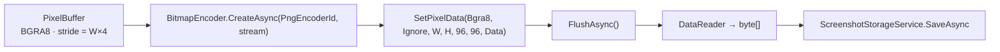

# Codificação PNG — Capture Engine

> O que "PNG sem perda de qualidade" significa no SharpShot, pixel a pixel, e o que o arquivo gravado contém.
> Fontes: [`PngImageEncoder.cs`](../../src/SharpShot.Capture/Encoding/PngImageEncoder.cs) · [`IImageEncoder.cs`](../../src/SharpShot.Core/Interfaces/IImageEncoder.cs) · [`PixelBuffer.cs`](../../src/SharpShot.Core/Models/PixelBuffer.cs) (verificados) · [ADR-04](../DECISIONS.md#adr-04--png-sem-perdas-como-único-formato-do-mvp).
> Última atualização: 04/nov/2026 · Mantenedor: Victor Alves

## Garantias

| Garantia | Como o código cumpre |
|----------|----------------------|
| **Sem perdas** | PNG é um formato sem perdas por definição (DEFLATE + filtros reversíveis). O WIC não tem modo "com perdas" para PNG |
| **Sem reamostragem** | `SetPixelData` recebe `pixels.Width × pixels.Height` exatos; nenhum `BitmapTransform` é aplicado |
| **Sem conversão de cor** | Formato de entrada `BitmapPixelFormat.Bgra8` — o mesmo do `PixelBuffer` e do frame pool; o WIC escreve RGB sem passar por outro espaço |
| **Alpha ignorado** | `BitmapAlphaMode.Ignore`: o PNG sai como RGB 8-bit (tipo de cor 2), sem canal alpha. Captura de desktop é opaca (`ForceOpaque()` já zera qualquer resíduo antes) |
| **DPI é só metadado** | `MetadataDpi = 96.0` vai para o chunk `pHYs`; não altera nenhum pixel. 96 DPI faz visualizadores mostrarem 1:1 |

## Pipeline

1. `InMemoryRandomAccessStream` recebe o PNG inteiro (tamanho típico: 1–8 MB para 1080p–4K com conteúdo de desktop; não medido — **pendente de validação**).
2. `FlushAsync` força o WIC a terminar a compressão.
3. O stream é lido para um `byte[]` — a camada de storage grava bytes, não conhece imagem (`IScreenshotStorage.SaveAsync(byte[] …)`).

## Opções do codificador que **não** são usadas (de propósito)

- **`PngFilterMode`**: deixado no default do WIC (adaptativo). Mudar filtro só altera o tamanho do arquivo, nunca os pixels.
- **Nível de compressão**: o WIC não expõe nível para PNG; o arquivo poderia ser menor com otimizadores externos (`oxipng`, `zopflipng`) — fora do MVP.
- **Metadados** (`tEXt` com software/data, `iCCP`): nenhum é gravado. O arquivo carrega só `IHDR`, `pHYs`, `IDAT`, `IEND` (o WIC pode acrescentar `sRGB`/`gAMA` — verificar com `pngcheck` no primeiro binário publicado: **pendente de validação**).

## Erros

Qualquer `COMException`, `InvalidOperationException`, `ArgumentException` ou `OutOfMemoryException` dentro do encoder vira `ScreenshotSaveException(SaveErrorKind.EncodingFailed)`. `OperationCanceledException` passa direto. Mensagem ao usuário: [`../architecture/erros.md`](../architecture/erros.md).

## Como provar que é sem perdas (teste planejado)

`tests/SharpShot.Capture.Tests` — round-trip:

1. Criar um `PixelBuffer` com padrão conhecido (gradientes + ruído, para cobrir todos os filtros do PNG).
2. `PngImageEncoder.EncodeAsync` → bytes.
3. `BitmapDecoder.CreateAsync` sobre os bytes → `GetPixelDataAsync(Bgra8, Ignore)`.
4. Comparar byte a byte com o buffer original (alpha forçado a 255 nos dois lados).

Resultado esperado: igualdade total. **Status: teste ainda não escrito** (a pasta de testes tem só o `.csproj`).

## Convenção de nome do arquivo

Definida em `SharpShot.Core.Services.FileNaming`, não aqui — ver [`../DATABASE.md`](../DATABASE.md#pasta-de-capturas-e-convenção-de-nomes). O encoder só informa `FileExtension = ".png"` e `FormatName = "PNG"`.

## Outros formatos

JPEG e WebP estão no roadmap ([`../PRD.md`](../PRD.md#roadmap-não-implementado)). A interface `IImageEncoder` foi desenhada para isso: o App escolhe o encoder, o storage grava bytes. Um `JpegImageEncoder` via WIC seria ~30 linhas — mas é uma decisão de produto ("com perdas" contradiz a promessa atual), não técnica.

---

HDR: [`hdr.md`](hdr.md) · Visão geral: [`README.md`](README.md) · Persistência: [`../DATABASE.md`](../DATABASE.md)
