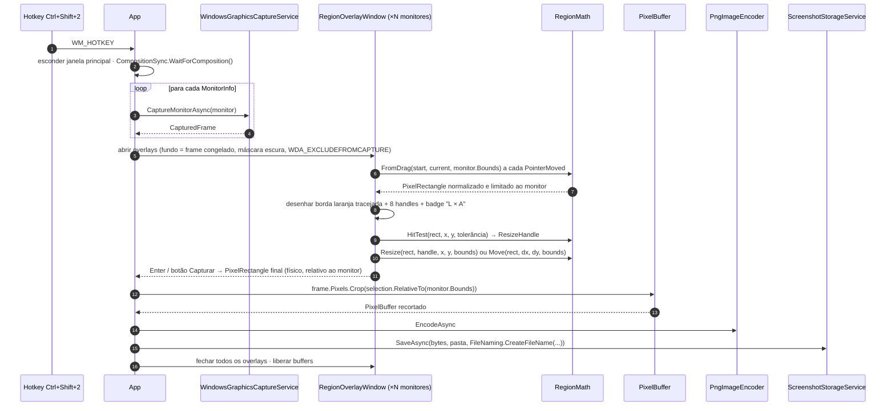

# Seleção de região — Capture Engine

> Como funciona o modo "Selecionar região" (`Ctrl+Shift+2`): o frame é congelado primeiro, o usuário desenha sobre a foto, e o recorte é feito em memória — nunca uma segunda captura.
> Fontes: [`RegionMath.cs`](../../src/SharpShot.Core/Services/RegionMath.cs) · [`PixelBuffer.cs`](../../src/SharpShot.Core/Models/PixelBuffer.cs) · [`ResizeHandle.cs`](../../src/SharpShot.Core/Enums/ResizeHandle.cs) · [`RegionOverlayWindow.xaml.cs`](../../src/SharpShot.App/Views/RegionOverlayWindow.xaml.cs) · [`RegionSelectionSession.cs`](../../src/SharpShot.App/Services/RegionSelectionSession.cs) (verificados) · [ADR-10](../DECISIONS.md#adr-10--seleção-de-região-sobre-frame-congelado-limitada-a-um-monitor).
> Última atualização: 04/nov/2026 · Mantenedor: Victor Alves

## Por que congelar primeiro

Alternativa descartada: mostrar um overlay transparente e capturar **depois** que o usuário soltar o mouse. Problemas: o overlay precisa sumir antes da captura (flicker), o conteúdo pode mudar entre o clique e a captura (tooltips, animações, vídeo) e a exclusão do overlay da captura depende de afinidade de janela funcionar.

Com o frame congelado:

1. Hotkey → o SharpShot captura **cada monitor** uma vez (`CaptureMonitorAsync` por `MonitorInfo`).
2. Abre um `RegionOverlayWindow` por monitor, em tela cheia, com o `PixelBuffer` daquele monitor como fundo (1:1, sem escala).
3. O usuário vê exatamente a foto que será recortada. O que estava na tela no instante do hotkey é o que sai no PNG.
4. Ao confirmar, `PixelBuffer.Crop(selection)` recorta em memória e o resultado vai para o encoder — **nenhuma nova captura**.

Custo: memória de um `PixelBuffer` por monitor durante a seleção (4 bytes × largura × altura; ~33 MB para 2880×1620) e o tempo de converter cada buffer em bitmap de fundo do overlay. Aceitável para um fluxo interativo.

## Fluxo

`Esc` ou o botão **Cancelar** fecham todos os overlays sem gravar nada.

## O que `RegionMath` garante (verificado no código)

| Função | Comportamento |
|--------|---------------|
| `FromDrag(startX, startY, currentX, currentY, bounds)` | Normaliza o arrasto em qualquer direção (`PixelRectangle.FromPoints`) e **clampa os dois pontos** ao monitor antes — a seleção nunca sai do monitor, mesmo com o mouse fora dele |
| `Clamp(rect, bounds)` | `Intersect`; vazio se não houver interseção |
| `Move(rect, dx, dy, bounds)` | Move sem deixar sair do monitor; retângulo maior que o monitor fica preso ao canto superior esquerdo |
| `HitTest(rect, x, y, tolerance)` | Cantos primeiro, depois arestas, depois `Move` (dentro) ou `None`; tolerância em pixels físicos |
| `Resize(rect, handle, x, y, bounds)` | Arrasta a aresta/canto escolhido mantendo o lado oposto ancorado; cruzar o lado oposto **inverte** o retângulo em vez de gerar tamanho negativo |
| `Flip(handle, horizontally, vertically)` | Handle oposto, para o cursor continuar coerente depois de uma inversão |
| `DipToPixel` / `PixelToDip` | Conversão de borda com a escala do monitor ([`dpi-e-monitores.md`](dpi-e-monitores.md)) |

`ResizeHandle` tem 10 valores: `None`, os 8 handles (`TopLeft`, `Top`, `TopRight`, `Right`, `BottomRight`, `Bottom`, `BottomLeft`, `Left`) e `Move`.

## O que `PixelBuffer.Crop` garante

- Lança `ArgumentException` para região vazia e `ArgumentOutOfRangeException` para região fora do buffer — **o chamador clampa antes** (`RegionMath.Clamp`), o `Crop` não corrige silenciosamente.
- Região igual ao buffer inteiro → cópia exata (`Data.Clone()`), não a mesma referência.
- Cópia linha a linha com `Buffer.BlockCopy`; sem reamostragem, sem conversão de formato.

## Interface do overlay (implementada — referência visual `public/assets/07-selecao-regiao-referencia.png`)

Mockup de referência: [`public/assets/07-selecao-regiao-referencia.png`](../../public/assets/07-selecao-regiao-referencia.png) *(mockup, não é captura do app rodando)*.

| Elemento | Especificação |
|----------|---------------|
| Fundo | Frame congelado do monitor, 1:1 em pixels físicos |
| Máscara | Escurecimento sobre tudo que está fora da seleção (`Background #0D1017` com opacidade) — ver [`../design-system/cores.md`](../design-system/cores.md) |
| Seleção | Borda tracejada em `Primary #FFAA35`, 8 handles quadrados, interior sem máscara |
| Badge de tamanho | `"1280 × 720"` em pixels físicos, próximo ao canto inferior direito da seleção (reposiciona para dentro quando encosta na borda do monitor) |
| Barra de ações | **Capturar** (primário) e **Cancelar**; aparece após a primeira seleção |
| Teclado | `Enter` = Capturar · `Esc` = Cancelar |
| Cursor | Cruz fora da seleção; setas de redimensionamento sobre os handles; "mover" dentro |
| Janela | Sem borda, topmost, um overlay por monitor, `WDA_EXCLUDEFROMCAPTURE` |

## Limitação assumida: um monitor por seleção

A seleção começa e termina no monitor onde o arrasto começou. Arrastar para outro monitor clampa ao primeiro. Motivos (ADR-10):

- Monitores com DPI diferente não têm uma grade de pixels comum — "um retângulo que atravessa" exigiria reamostrar um dos lados, e o SharpShot não reamostra.
- Um único `PixelBuffer` contínuo do desktop virtual exigiria compor os frames em memória, com lacunas (monitores não alinhados) preenchidas artificialmente.
- O caso de uso "janela que atravessa dois monitores" é raro e tem como alternativa capturar os dois monitores separadamente.

## Testes relacionados (`tests/SharpShot.Core.Tests`)

- `FromDrag` nas quatro direções de arrasto produz o mesmo retângulo.
- `FromDrag` com ponto fora do monitor → retângulo limitado ao monitor.
- `HitTest` em cada canto/aresta/interior/exterior, com e sem tolerância.
- `Resize` cruzando o lado oposto inverte sem tamanho negativo; `Flip` devolve o handle oposto.
- `PixelBuffer.Crop` de sub-região devolve pixels corretos (`GetPixel`), e região fora lança.

---

DPI: [`dpi-e-monitores.md`](dpi-e-monitores.md) · Fluxo geral: [`README.md`](README.md) · Design do overlay: [`../design-system/componentes.md`](../design-system/componentes.md)
