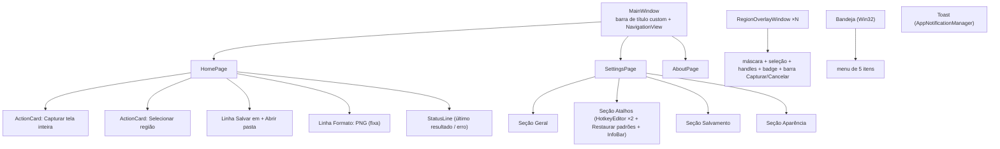

# Componentes e telas — Design system

> Cada tela e peça do SharpShot: composição, controles WinUI 3 usados, textos em pt-BR e estados. É a especificação que o App segue (`src/SharpShot.App/Views` e `Components`); os mockups em `public/assets/` são referência de hierarquia, não de pixel.
> Fontes: [`../PRD.md`](../PRD.md) · [`../project-context/requisitos.md`](../project-context/requisitos.md) · `AppSettings`/`HotkeyBinding` (verificados) · mockups `05/06/07-*.png`.
> Última atualização: 04/nov/2026 · Mantenedor: Victor Alves

## Mapa



## Barra de título (`MainWindow`)

- `ExtendsContentIntoTitleBar = true`; `SetTitleBar(customGrid)`.
- Conteúdo: logo (`PathIcon`/`Path` com `LogoGeometry.TopBracket`, `LowerSilver`, `UpperSilver`, `BottomBracket`) 20 DIP + wordmark "SharpShot" (`Caption`, Semibold). Área arrastável = toda a barra menos os caption buttons.
- Fundo `SharpShotSurfaceBrush`; caption buttons com cores configuradas no `AppWindow.TitleBar` por tema.
- Sem ícone genérico: o logo é sempre o path gerado ([ADR-13](../DECISIONS.md)).

## Shell (`NavigationView`)

| Item | Ícone (Segoe Fluent) | Página |
|------|----------------------|--------|
| Início | `&#xE80F;` Home | `HomePage` |
| Configurações | `&#xE713;` Setting | `SettingsPage` |
| Sobre | `&#xE946;` Info | `AboutPage` |

`PaneDisplayMode="LeftCompact"`, `IsBackButtonVisible="Collapsed"`, `IsSettingsVisible="False"` (Configurações é item normal para ficar na ordem). Sem "Histórico" no MVP. Navegação por `Frame.Navigate(typeof(Page))` sem animação custom.

## Início (`HomePage`)

Referência: `public/assets/05-tela-inicial-referencia.png` *(mockup)*.

| Peça | Composição | Texto |
|------|------------|-------|
| **ActionCard** ×2 | `Button` estilizado como card (`Surface`, raio 8, padding 16): ícone 32 DIP + título `BodyStrong` + atalho `Caption` secundário; hover = `SharpShotPrimaryBrush` na borda 1 px; pressed = fundo levemente mais claro | "Capturar tela inteira" / "Ctrl + Shift + 1" · "Selecionar região" / "Ctrl + Shift + 2" (atalhos vêm de `HotkeyBinding.ToDisplayString()`, nunca fixos) |
| **Linha "Salvar em"** | `TextBlock` rótulo + caminho (trimming + tooltip) + `HyperlinkButton`/`Button` "Abrir pasta" | "Salvar em: C:\Users\…\Pictures\SharpShot" (pasta **resolvida**) |
| **Linha "Formato"** | `TextBlock` fixo, sem controle | "Formato: PNG (sem perda de qualidade)" |
| **StatusLine** | `InfoBar` não fechável (`IsClosable="False"`) ou `TextBlock` + ícone: Success após captura, Error após falha, vazio no início | "Última captura: SharpShot_2026-11-04_14-32-07-583.png (2560 × 1440)" · mensagem de [`../architecture/erros.md`](../architecture/erros.md) |

Clique no card dispara o mesmo `ICaptureCoordinator` do hotkey; durante a captura os cards ficam desabilitados (reentrância) — ver [`estados.md`](estados.md).

## Configurações (`SettingsPage`)

Referência: `public/assets/06-configuracoes-referencia.png` *(mockup)*. Cada seção = cabeçalho `Subtitle` + lista de **SettingRow** (rótulo `BodyStrong` + descrição `Caption` à esquerda; controle à direita; `Surface`, raio 8, padding 16 — padrão visual do `SettingsCard` do Toolkit, reconstruído sem a dependência).

### Geral

| Linha | Controle | Texto | Liga a |
|-------|----------|-------|--------|
| Iniciar com o Windows | `ToggleSwitch` | "Iniciar com o Windows" / "Abre minimizado na bandeja ao entrar no Windows." | `StartWithWindows` + chave `Run` |
| Minimizar para a bandeja | `ToggleSwitch` | "Minimizar para a bandeja ao fechar" / "O SharpShot continua ativo e os atalhos funcionam." | `MinimizeToTray` |
| Notificação | `ToggleSwitch` | "Mostrar notificação após capturar" | `ShowNotificationAfterCapture` |

### Atalhos

| Linha | Controle | Texto |
|-------|----------|-------|
| Tela inteira | **HotkeyEditor** | "Capturar tela inteira" · valor "Ctrl + Shift + 1" |
| Região | **HotkeyEditor** | "Selecionar região" · valor "Ctrl + Shift + 2" |
| — | `Button` secundário | "Restaurar padrões" |
| — | `InfoBar` Warning (oculto por padrão) | "O atalho Ctrl + Shift + 1 já está em uso por outro aplicativo. Escolha outra combinação." |

**HotkeyEditor:** `Button`/`TextBox` somente leitura que, ao receber foco e um `KeyDown`, lê modificadores + tecla (`VirtualKeyNames.IsAssignable`), exige ≥ 1 modificador, mostra "Pressione a combinação…" enquanto espera, `Esc` cancela a edição, `Backspace` não limpa (um atalho não pode ficar vazio). Aplica via `HotkeyService.TryRebind`; conflito → `InfoBar` e valor anterior.

### Salvamento

| Linha | Controle | Texto |
|-------|----------|-------|
| Pasta | `TextBox` (caminho, valida a cada edição com `ValidateDirectory`) + `Button` "Procurar…" (`FolderPicker`) + `Button` "Abrir pasta" | "Pasta de salvamento" / vazio = "Padrão: Imagens\SharpShot"; erro inline com a mensagem de `PathValidator` |
| Convenção | `TextBlock` `Caption` | "Os arquivos são salvos como SharpShot_AAAA-MM-DD_HH-mm-ss-fff.png e nunca são sobrescritos." |

### Aparência

| Linha | Controle | Texto |
|-------|----------|-------|
| Tema | `RadioButtons` (3) | "Seguir o sistema" · "Claro" · "Escuro" |

Toda mudança salva na hora (`SaveAsync`) — sem botão "Salvar"/"Aplicar".

## Sobre (`AboutPage`)

Logo 96 DIP, "SharpShot" (`Subtitle`), "Versão 0.1.0" (`BodyLarge`, lido de `Assembly.GetName().Version`/`InformationalVersion`), "Licença MIT · Copyright (c) 2026 Victor Alves", `HyperlinkButton` para o repositório, lista de créditos de terceiros (mesma do README), e — **decisão pendente** — botão "Abrir pasta de logs" e "Remover registro de notificações".

## Overlay de região (`RegionOverlayWindow`)

Referência: `public/assets/07-selecao-regiao-referencia.png` *(mockup)*. Especificação completa em [`../capture-engine/regiao.md`](../capture-engine/regiao.md).

| Peça | Composição |
|------|------------|
| Janela | Sem borda, sem barra, topmost, cobre `MonitorInfo.Bounds`; `WDA_EXCLUDEFROMCAPTURE`; uma por monitor |
| Fundo | `Image`/`SoftwareBitmapSource` com o frame congelado, `Stretch="None"`, alinhado ao canto |
| Máscara | `Path` com geometria "retângulo do monitor menos a seleção" (`GeometryGroup` `EvenOdd`), `SharpShotBackgroundBrush` 60 % |
| Seleção | `Rectangle` sem preenchimento, `Stroke` `Primary` 2 px físicos, `StrokeDashArray` 6/4 |
| Handles | 8 `Rectangle` 8 px físicos, `Primary` com contorno `Background` 1 px |
| Badge | `Border` `Surface` 90 % + `TextBlock` "1280 × 720" (numerais tabulares) |
| Barra | `StackPanel` horizontal: `Button` primário "Capturar", `Button` "Cancelar"; aparece após a primeira seleção |
| Teclado | `Enter` = Capturar · `Esc` = Cancelar · **setas/Shift+setas para ajustar: pendente de decisão** |
| Cursor | `CoreCursorType.Cross` fora; `SizeNorthwestSoutheast` etc. nos handles; `SizeAll` dentro |

## Bandeja (Win32)

Ícone `Tray.ico` (monocromático prata/laranja em tile escuro — gerado). Tooltip "SharpShot". Clique esquerdo = Abrir SharpShot. Clique direito = menu:

```text
Capturar tela inteira        Ctrl+Shift+1
Selecionar região            Ctrl+Shift+2
─────────────────────────────
Abrir SharpShot
Abrir pasta de capturas
─────────────────────────────
Sair
```

Menu nativo (`TrackPopupMenuEx`), segue o tema do sistema ([ADR-06](../DECISIONS.md)).

## Toast (`AppNotificationManager`)

| Campo | Valor |
|-------|-------|
| Título | "Captura salva com sucesso!" |
| Corpo | nome do arquivo (`CaptureResult.FileName`) |
| Imagem | `Assets/NotificationLogo.png` (app logo override) — opcional: miniatura da captura como *hero image* (**decisão pendente**: custo de gerar thumbnail) |
| Botões | "Abrir pasta" (`explorer /select,<caminho>`) · "Ver imagem" (`ShellExecute` no arquivo) |
| Erro | Título "Não foi possível salvar a captura" + mensagem de [`../architecture/erros.md`](../architecture/erros.md); botão "Abrir Configurações" quando a ação sugerida for essa |

Segue o tema do sistema ([ADR-07](../DECISIONS.md)); respeita o Foco Assistido.

## Componentes reutilizáveis (`App/Components`)

| Componente | Base | Onde |
|------------|------|------|
| `ActionCard` | `Button` + `ControlTemplate` | Home |
| `SettingRow` | `UserControl` (rótulo, descrição, `ContentPresenter` para o controle) | Configurações |
| `HotkeyEditor` | `UserControl` | Configurações → Atalhos |
| `StatusLine` | `InfoBar` configurado | Home |
| `LogoView` | `Viewbox` + 4 `Path` de `LogoGeometry` com brushes por tema | Barra de título, Sobre |

Antes de criar um componente novo, procure aqui. Nenhum deles vem de pacote externo.

---

Estados: [`estados.md`](estados.md) · Ícones: [`icones.md`](icones.md) · Espaçamento: [`espacamento.md`](espacamento.md) · Seleção de região: [`../capture-engine/regiao.md`](../capture-engine/regiao.md)
