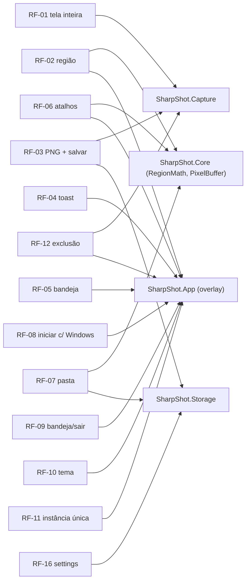

# Requisitos — SharpShot

> Requisitos funcionais (RF) e não funcionais (RNF) do MVP 0.1.0, com prioridade, status no código e onde cada um é verificado. IDs são **estáveis**: não renumerar; requisito retirado fica marcado "retirado", não some.
> Legenda de status: **implementado** (verificado no código em 04/nov/2026) · **em implementação** (App, sendo escrito) · **planejado** (testes) · **pendente de validação** (existe, não foi executado) · **roadmap**.
> Fontes: [`README.md`](README.md) · [`../PRD.md`](../PRD.md) · código em `src/` · [`criterios-de-aceitacao.md`](criterios-de-aceitacao.md).
> Última atualização: 04/nov/2026 · Mantenedor: Victor Alves

## Requisitos funcionais

Prioridade: **Deve** (inegociável no MVP) · **Deveria** (entra se couber) · **Poderia** (roadmap).

| ID | Requisito | Prioridade | Onde no código | Status | CA |
|----|-----------|------------|----------------|--------|----|
| **RF-01** | **Captura de tela inteira.** Ao disparar `Ctrl+Shift+1` (atalho global, configurável), clicar no card "Capturar tela inteira" da Home ou escolher o item na bandeja, o app captura o **monitor sob o cursor** em pixels físicos e salva como PNG | Deve | `IScreenCaptureService` / `WindowsGraphicsCaptureService`, `IMonitorService.GetMonitorUnderCursor`; disparo no App | motor implementado · App em implementação | CA-01, CA-04 |
| **RF-02** | **Seleção de região.** `Ctrl+Shift+2` captura todos os monitores, abre um overlay por monitor com o frame congelado como fundo, máscara fora da seleção, borda laranja tracejada, 8 handles de redimensionamento, arrasto do interior para mover e badge "L × A" em pixels físicos; `Enter`/**Capturar** confirma, `Esc`/**Cancelar** aborta; a seleção não atravessa monitores | Deve | `RegionMath`, `ResizeHandle`, `PixelBuffer.Crop` (Core); `RegionOverlayWindow` (App) | geometria implementada · overlay em implementação | CA-03, CA-06 |
| **RF-03** | **Salvar PNG sem perdas.** O arquivo é PNG RGB 8-bit sem reamostragem, sem conversão de cor, alpha ignorado; gravado na pasta configurada (padrão `Imagens\SharpShot`), criada se não existir; nome `SharpShot_yyyy-MM-dd_HH-mm-ss-fff.png`; **nunca sobrescreve** (sufixo `_1`, `_2`…) | Deve | `PngImageEncoder`, `ScreenshotStorageService`, `FileNaming` | implementado | CA-02, CA-05 |
| **RF-04** | **Notificação pós-captura.** Toast "Captura salva com sucesso!" com o nome do arquivo e botões **Abrir pasta** (Explorer com o arquivo selecionado) e **Ver imagem** (visualizador padrão); desligável em Configurações; se o sistema não suportar, o app segue sem toast | Deve | `AppNotificationManager` (App) | em implementação | CA-07 |
| **RF-05** | **Ícone na bandeja.** Menu com Capturar tela inteira · Selecionar região · Abrir SharpShot · Abrir pasta de capturas · Sair; clique simples abre o app; ícone readicionado quando o Explorer reinicia (`TaskbarCreated`) | Deve | `Shell_NotifyIcon` (App) | em implementação | CA-10 |
| **RF-06** | **Atalhos configuráveis.** Editor que captura a combinação pressionada (exige ≥ 1 modificador e tecla atribuível), **Restaurar padrões** (`Ctrl+Shift+1`/`2`), aplicação imediata, e detecção de conflito (`ERROR_HOTKEY_ALREADY_REGISTERED`) mostrada em `InfoBar` sem derrubar o atalho anterior | Deve | `HotkeyBinding`, `VirtualKeyNames` (Core); `RegisterHotKey` + página (App) | modelo implementado · UI em implementação | CA-11 |
| **RF-07** | **Pasta configurável.** Campo de caminho + **Procurar…** + **Abrir pasta**; validação sintática (caminho completo, sem caracteres inválidos, sem nomes reservados, sem terminar em espaço/ponto) com mensagem em pt-BR; vazio = padrão; aceita `%VARIAVEL%` | Deve | `PathValidator`, `IScreenshotStorage.ValidateDirectory/ResolveDirectory` | validação implementada · UI em implementação | CA-08 |
| **RF-08** | **Iniciar com o Windows.** Toggle que cria/remove `HKCU\…\Run\SharpShot` = `"<exe>" --minimized`; o app lê o estado real da chave ao abrir Configurações | Deve | App (registro) | em implementação | CA-12 |
| **RF-09** | **Minimizar para a bandeja e Sair.** Fechar a janela esconde na bandeja quando a opção está ligada (padrão) — caso contrário encerra; **Sair** (menu ou página) encerra liberando hotkeys, ícone e registro de notificação | Deve | App | em implementação | CA-13 |
| **RF-10** | **Tema.** Seguir o sistema (padrão) / Claro / Escuro, aplicado imediatamente e persistido | Deve | `ThemeMode` (Core); `ElementTheme` (App) | modelo implementado · UI em implementação | CA-14 |
| **RF-11** | **Instância única.** Executar o app de novo ativa a janela da instância existente (ou mostra, se estava na bandeja) e encerra a nova | Deve | `AppInstance.FindOrRegisterForKey` (App) | em implementação | CA-15 |
| **RF-12** | **Exclusão das janelas do app.** Nenhuma janela do SharpShot (principal, overlays) aparece em nenhuma captura: `WDA_EXCLUDEFROMCAPTURE` + esconder a principal + `DwmFlush` ×2 antes de capturar | Deve | `CompositionSync` (Capture); afinidade (App) | parcialmente implementado · App em implementação | CA-04 |
| **RF-13** | **Página Sobre.** Logo, nome, versão (`0.1.0`), licença MIT, link do repositório, créditos de terceiros | Deveria | App | em implementação | CA-16 |
| **RF-14** | **Logs locais.** Eventos de captura/gravação/configuração e exceções em `%LOCALAPPDATA%\SharpShot\logs`; nível `Debug` também no Output do VS; sem conteúdo de imagem | Deveria | `ILogger` (todas as camadas); provider de arquivo (App) | logging implementado nas camadas · provider em implementação | CA-17 |
| **RF-15** | **Linha de status na Home.** Mostra o caminho da última captura ou a mensagem de erro classificada; linha fixa "PNG (sem perda de qualidade)"; linha "Salvar em" com a pasta efetiva | Deveria | `CaptureResult` (Core); HomePage (App) | em implementação | CA-18 |
| **RF-16** | **Configurações persistidas.** Toda preferência gravada em `settings.json` atômico, com recuperação de arquivo corrompido (backup + padrões) e normalização de valores inválidos | Deve | `SettingsService`, `AppSettings` | implementado | CA-09 |
| RF-17 | Histórico de capturas | Poderia | — | roadmap | — |
| RF-18 | Captura de janela | Poderia | `CreateForWindow` declarado | roadmap | — |
| RF-19 | Captura com cursor (opção) | Poderia | `IsCursorCaptureEnabled` | roadmap | — |
| RF-20 | Copiar para a área de transferência | Poderia | — | roadmap | — |
| RF-21 | JPEG / WebP | Poderia | `IImageEncoder` | roadmap | — |
| RF-22 | Anotações | Poderia | — | roadmap | — |

## Requisitos não funcionais

| ID | Requisito | Meta | Verificação | Status |
|----|-----------|------|-------------|--------|
| **RNF-01** | **Fidelidade de imagem** | PNG byte-idêntico ao frame capturado; sem reamostragem, filtro ou conversão de cor; captura em pixels físicos | Teste de round-trip `EncodeAsync` → `BitmapDecoder` (planejado); inspeção de `SetPixelData` (sem transform) | implementado · teste planejado |
| **RNF-02** | **Compatibilidade** | Windows 10 2004 (19041)+ e Windows 11; x64 e arm64; self-contained (sem .NET nem Windows App SDK instalados) | `TargetPlatformMinVersion`, `RuntimeIdentifiers`; teste em VM limpa (CA-20) | configurado · pendente de validação |
| **RNF-03** | **DPI** | PerMonitorV2; coordenadas físicas em todo o motor; conversão DIP↔pixel só na borda; coordenadas negativas suportadas | `app.manifest`; testes de `RegionMath`/`PixelRectangle` (planejados); CA-01/CA-03 em setup multi-DPI | implementado · validação pendente |
| **RNF-04** | **Privacidade / offline** | Nenhuma conexão de rede; nenhum pacote de rede; nenhuma telemetria; dados só em `HKCU`, `%LOCALAPPDATA%` e pasta do usuário | Revisão de `Directory.Packages.props`; monitor de rede durante uso (manual) | implementado por desenho (ADR-15) |
| **RNF-05** | **Robustez** | Todo erro de captura/gravação classificado (`CaptureErrorKind` 7 valores, `SaveErrorKind` 7 valores) e explicado em pt-BR com ação; nenhuma falha silenciosa; nunca sobrescreve; arquivo parcial removido | Testes de classificação (planejados); [`../architecture/erros.md`](../architecture/erros.md) | classificação implementada · mensagens em implementação |
| **RNF-06** | **Recursos** | Item, frame pool, sessão, frame e `SoftwareBitmap` descartados a cada captura; device D3D cacheado e recriado após device-lost; sem vazamento após N capturas | Revisão de `using`/`finally` (feita); medição de memória após 100 capturas (**pendente**) | implementado · medição pendente |
| **RNF-07** | **Desempenho** | Captura percebida como instantânea; timeout de 5 s para o primeiro frame; WARP como fallback funcional | **Sem meta numérica até medir.** Medir tempo hotkey→arquivo e pico de memória em 1080p e 4K (pendente) | pendente de medição |
| **RNF-08** | **Instalação** | Sem admin, sem instalador; copiar pasta e executar; desinstalar = apagar pasta + `HKCU\…\Run` + `%LOCALAPPDATA%\SharpShot` + registro de notificação | [`../distribution/instalacao.md`](../distribution/instalacao.md); CA-20 | configurado · pendente de validação |
| **RNF-09** | **Qualidade de engenharia** | `Nullable=enable`, `AnalysisLevel=latest-recommended`, `.editorconfig` aplicado; `Core`/`Storage` sem Windows; xUnit; CI restore+build+test+publish | `Directory.Build.props`; `build.yml`; testes | configurado · testes planejados · CI a escrever |
| **RNF-10** | **UX nativa e acessível** | WinUI 3/Fluent com controles de estoque; teclado completo (`Enter`/`Esc`, `Tab`); contraste AA nos três temas; `AutomationProperties.Name` em controles sem texto | [`../DESIGN.md`](../DESIGN.md); revisão manual | em implementação |
| **RNF-11** | **Idioma** | UI, toasts, menu e mensagens em pt-BR; código, logs e exceções em inglês | Revisão | implementado (ADR-14) |

## Rastreabilidade

## Divergências entre brief e código (registradas)

- Frame pool: o brief inicial falava em 1 buffer; o código usa **2** (`CreateFreeThreaded(..., 2, size)`). O doc segue o código.
- Mensagem de `NotSupported` cita "Windows 10 1903+"; o mínimo real é 2004 (19041). Correção pendente no código.
- Monitor da captura de tela inteira: "sob o cursor" é o comportamento suportado por `IMonitorService` e assumido aqui; **confirmar no App**.

---

Contexto: [`README.md`](README.md) · Critérios: [`criterios-de-aceitacao.md`](criterios-de-aceitacao.md) · PRD: [`../PRD.md`](../PRD.md) · Decisões: [`../DECISIONS.md`](../DECISIONS.md)
